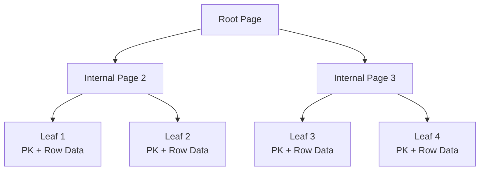
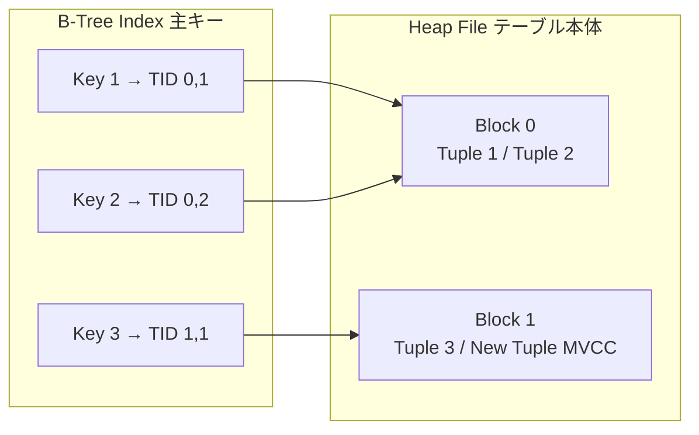

<!--
================================================================
 表紙
================================================================
 全面を絶対配置で組んでいる。置くものは 4 つだけ。

   枠      ... スライドの縁の内側に 1 本。消さない
   タイトル ... 左。上に寄せすぎず、縦の 1/3 あたりに置く
   イベント ... 右上。無いときは span ごと消す
   発表者   ... 左下。名前と日付

 ---- 枠 ------------------------------------------------------------
 スライドの地を薄い緑のグラデーションで塗り、内側 18px に白いパネルを載せている。
 外周の帯がそのまま枠になる。帯の幅は変えない。
 濃さを変えるなら styles/index.css の --c-cover-band を動かす。

 遊びの線は全面の <svg> にまとめてある。3 つだけ。
   ・左から入って渦を巻く線。帯をまたいで外から入ってくる
   ・右下と上の白い短い線。色帯の上に乗せて枠を切る
 増やさない。増やすと表紙が散らかる。

 ---- 題材のアイコン ------------------------------------------------
 タイトルの右、同じ高さに 1 つだけ置く。その回の題材をデフォルメしたもの。

   <div class="i-ph-database-fill w-[74px] h-[74px]" style="color: var(--c-accent-ink)"></div>

 ・塗りつぶしのアイコンを選ぶ。線画だと枠の中で痩せて見える
   ph の -fill 付き（i-ph-rocket-launch-fill など）が使いやすい
 ・logos の色付きロゴを入れるときは style の color を外す
 ・枠の大きさと位置は動かさない。タイトルと高さを揃えてある
 ・2 つ以上置かない

 ---- 風景 ----------------------------------------------------------
 右下にデフォルメした風景。画面のおよそ 3 割。
 ビルはアクセントの空色（--c-accent / --c-accent-deep / --c-accent-soft）、
 地面とアンテナは ink。名刺と同じ色づかいに揃えてある。
 右上がりにして左へ溶かす。左端はマスクで消しているので縦の切れ目ができない。

 グラデーションは <defs> にまとめてある。4 つだけ。
   cvGlow   右上のぼんやりした光。中心から外へ消える
   cvBack   奥のビル。下へ行くほど薄くなる
   cvFront  手前のビル。上から下へ濃くなる
   cvGround 地面。上が少し明るい
 色はすべて var(--c-*) を stop-color に入れている。直接の色コードを書かない。

 紙飛行機は小さいまま。後ろから見た形にして、奥へ飛んでいくように見せる。
 軌跡はくねくねさせて、根元が消えるグラデーション（cvTrail）をかけてある。
 向きは軌跡の終わりと揃える。角度を変えたら rotate の値も合わせる。

 差し替えるなら画像を public/ に置いて

   

 に入れ替える。
 サブタイトルは置かない。言いたいことはタイトル 1 行に収める。

 注意 2 つ。どちらも Vue のコンパイルが落ちる。
 ・HTML の開きタグは 1 行に収める。属性を改行でまたがない
 ・SVG の中に空行を入れない。空行で HTML ブロックが切れ、
   そのあとの深いインデントがコードブロック扱いになる
================================================================
-->

<div class="relative w-full h-full" style="background: linear-gradient(135deg, var(--c-accent-soft) 0%, var(--c-cover-band) 100%)">

  <div class="absolute inset-[18px] rounded-2xl overflow-hidden" style="background: var(--c-bg)">
    <div class="absolute inset-0 u-grid-paper" style="opacity: 0.9; -webkit-mask-image: linear-gradient(115deg, transparent 30%, #000 88%); mask-image: linear-gradient(115deg, transparent 30%, #000 88%)"></div>
  </div>

  <div class="absolute right-[18px] bottom-[18px] w-[690px] overflow-hidden" style="border-bottom-right-radius: 16px; -webkit-mask-image: linear-gradient(90deg, transparent 0%, #000 30%); mask-image: linear-gradient(90deg, transparent 0%, #000 30%)">
    <svg viewBox="0 0 580 280" class="w-full block">
      <defs>
        <radialGradient id="cvGlow">
          <stop offset="0" stop-color="var(--c-accent-soft)" />
          <stop offset="1" stop-color="var(--c-accent-soft)" stop-opacity="0" />
        </radialGradient>
        <linearGradient id="cvBack" x1="0" y1="0" x2="0" y2="1">
          <stop offset="0" stop-color="var(--c-accent-soft)" />
          <stop offset="1" stop-color="var(--c-accent-soft)" stop-opacity="0.3" />
        </linearGradient>
        <linearGradient id="cvFront" x1="0" y1="0" x2="0" y2="1">
          <stop offset="0" stop-color="var(--c-accent)" />
          <stop offset="1" stop-color="var(--c-accent-deep)" />
        </linearGradient>
        <linearGradient id="cvTrail" x1="0" y1="1" x2="1" y2="0">
          <stop offset="0" stop-color="var(--c-ink-3)" stop-opacity="0" />
          <stop offset="1" stop-color="var(--c-ink-3)" stop-opacity="1" />
        </linearGradient>
        <linearGradient id="cvGround" x1="0" y1="0" x2="0" y2="1">
          <stop offset="0" stop-color="var(--c-ink-2)" />
          <stop offset="1" stop-color="var(--c-ink)" />
        </linearGradient>
      </defs>
      <circle cx="486" cy="58" r="76" fill="url(#cvGlow)" />
      <path d="M104 234 C 140 220 130 190 164 178 C 198 166 188 142 216 132" stroke="url(#cvTrail)" stroke-width="2.5" stroke-dasharray="3 8" stroke-linecap="round" fill="none" />
      <g transform="translate(224 128) rotate(58)">
        <path d="M0 0 L-13 21 L0 14 L13 21 Z" fill="var(--c-ink-2)" />
        <path d="M0 0 L0 14" stroke="var(--c-bg)" stroke-width="1.2" fill="none" />
      </g>
      <rect x="296" y="176" width="44" height="80" rx="6" fill="url(#cvBack)" />
      <rect x="348" y="156" width="34" height="100" rx="6" fill="url(#cvBack)" />
      <rect x="390" y="140" width="50" height="116" rx="6" fill="url(#cvBack)" />
      <rect x="448" y="164" width="36" height="92" rx="6" fill="url(#cvBack)" />
      <rect x="492" y="132" width="46" height="124" rx="6" fill="url(#cvBack)" />
      <rect x="546" y="160" width="34" height="96" rx="6" fill="url(#cvBack)" />
      <path d="M365 156 V128" stroke="var(--c-ink)" stroke-width="2.5" stroke-linecap="round" />
      <circle cx="365" cy="124" r="5" fill="var(--c-ink)" />
      <path d="M515 132 V102" stroke="var(--c-ink)" stroke-width="2.5" stroke-linecap="round" />
      <circle cx="515" cy="98" r="5" fill="var(--c-ink)" />
      <path d="M365 128 C 412 160 470 150 515 104" stroke="var(--c-ink)" stroke-width="2" fill="none" stroke-linecap="round" />
      <rect x="318" y="200" width="48" height="60" rx="6" fill="url(#cvFront)" />
      <rect x="374" y="182" width="40" height="78" rx="6" fill="url(#cvFront)" />
      <rect x="422" y="192" width="56" height="68" rx="6" fill="url(#cvFront)" />
      <rect x="486" y="170" width="42" height="90" rx="6" fill="url(#cvFront)" />
      <rect x="536" y="186" width="38" height="74" rx="6" fill="url(#cvFront)" />
      <g fill="var(--c-bg)">
        <rect x="328" y="212" width="9" height="9" rx="2" />
        <rect x="345" y="212" width="9" height="9" rx="2" />
        <rect x="328" y="230" width="9" height="9" rx="2" />
        <rect x="384" y="196" width="9" height="9" rx="2" />
        <rect x="397" y="196" width="9" height="9" rx="2" />
        <rect x="384" y="214" width="9" height="9" rx="2" />
        <rect x="434" y="206" width="9" height="9" rx="2" />
        <rect x="451" y="206" width="9" height="9" rx="2" />
        <rect x="434" y="224" width="9" height="9" rx="2" />
        <rect x="496" y="184" width="9" height="9" rx="2" />
        <rect x="509" y="184" width="9" height="9" rx="2" />
        <rect x="496" y="202" width="9" height="9" rx="2" />
        <rect x="546" y="200" width="9" height="9" rx="2" />
        <rect x="559" y="200" width="9" height="9" rx="2" />
      </g>
      <rect x="451" y="224" width="9" height="9" rx="2" fill="var(--c-accent-soft)" />
      <rect x="509" y="202" width="9" height="9" rx="2" fill="var(--c-accent-soft)" />
      <rect x="402" y="230" width="4" height="13" rx="1.5" fill="var(--c-bg)" />
      <path d="M0 262 C 140 256 300 244 420 236 C 500 231 540 229 580 228 L580 280 L0 280 Z" fill="url(#cvGround)" />
    </svg>
  </div>

  <svg class="absolute inset-0 w-full h-full pointer-events-none" viewBox="0 0 980 552" fill="none">
    <path d="M0 312 H56 a26 26 0 1 1 26 -26 a16 16 0 1 0 -16 16" stroke="var(--c-ink)" stroke-width="3" stroke-linecap="round" />
    <path d="M948 470 H980" stroke="var(--c-bg)" stroke-width="3" stroke-linecap="round" />
    <path d="M700 18 V0" stroke="var(--c-bg)" stroke-width="3" stroke-linecap="round" />
  </svg>

  <div class="absolute right-16 top-16 u-12 u-faint">テック文化祭 _findy</div>

  <div class="absolute left-16 top-[29%]">

# DBMS、キモくね？

  </div>

  <div class="absolute right-[120px] top-[124px] w-[132px] h-[132px] rounded-[34px] flex items-center justify-center" style="background: var(--c-accent-soft)">
    <div class="i-ph-database-fill w-[74px] h-[74px]" style="color: var(--c-accent-ink)"></div>
  </div>

  <div class="absolute left-16 bottom-16 flex items-baseline gap-6 u-12 u-faint">
    <span>はやと</span>
    <span>2026/09/26</span>
  </div>

</div>

---
hideInToc: true
---

# 目次

<Toc :columns="1" :maxDepth="1" />

---
layout: section
---

# 自己紹介

---
hideInToc: true
---

<!--
================================================================
 自己紹介
================================================================
 名刺と同じ作り。空色の面、方眼紙、細くて字間の広いラテン。
 手描きの線は使わない。

 ---- 置き方 --------------------------------------------------------
 左  肩書き → 名前 → ローマ字 → ラベル + 内容 の 5 行
 右  丸い顔だけ。後ろに面を敷かない

 見出しは「自己紹介」ではなく名前そのもの。章扉が直前で名乗っているので
 ここで繰り返さない。

 ---- ラテン --------------------------------------------------------
 Space Grotesk の 300。字間を 0.3em まで開ける。
 太字にしない。細くて広いから名刺の空気になる。

 ---- 大きさの付け方 ------------------------------------------------
 名刺と同じで「小さい → 大きい」の落差で見せる。
   肩書き   12px  細いラテン。名前の前に小さく置く
   名前     36px  ここだけ重い。1 枚の主役
   ローマ字 20px  細くて広い。名前を受ける
   ラベル   12px  空色の濃い方。内容の上に置く
   内容     20px  客席から読める大きさ。ラベルより少し右へ下げる
 12 と 36 を隣に置くのが効く。中間のサイズで埋めない。

 ---- 右 ------------------------------------------------------------
 丸い顔を 1 つ置くだけ。後ろに面や図形を敷かない。地の方眼に直接置く。
 高さはスライドの上下中央。top の値はそれに合わせた実測値なので、
 名前の行数を変えたら中央に戻るよう取り直す。
 写真にするときは枠の中のコメントの img を出してアイコンの div を消す。
 写真は正方形。

 ---- 5 つの項目 ----------------------------------------------------
 出身地 / 経歴 / 長所 / 趣味 / 最近 の順で固定。
 ラベルを上、その少し右下に内容を置く。横に並べない。
 ラベルは 12px の空色の濃い方。内容は 20px の黒。
 内容は短い 1 文でよい。ただし 1 行に収める。
 折り返すと 5 つ入らなくなるので、入らないなら文を削る。

 ---- 動き ----------------------------------------------------------
 v-motion で自動。顔 → ローマ字 → 5 行 の順。
 delay は 80 / 170 / 300 / 420 / 490 / 560 / 630 / 700。
 肩書きは h1 の直前に普通に流して置く。絶対配置にすると h1 に重なる。
================================================================
-->

<div class="u-12 mb-1" style="font-family: 'Space Grotesk', sans-serif; font-weight: 300; letter-spacing: 0.3em; color: var(--c-accent-ink)">SOFTWARE ENGINEER</div>

# 那須 隼人

<div class="relative h-[400px] -mt-2">
  <div class="absolute left-0 top-[2px] u-20" style="font-family: 'Space Grotesk', sans-serif; font-weight: 300; letter-spacing: 0.3em; color: var(--c-ink-2)" v-motion :initial="{ y: 12, opacity: 0 }" :enter="{ y: 0, opacity: 1, transition: { delay: 170, duration: 620 } }">HAYATO NASU</div>
  <div class="absolute left-0 top-[78px] w-[510px] flex flex-col gap-3">
    <div v-motion :initial="{ y: 10, opacity: 0 }" :enter="{ y: 0, opacity: 1, transition: { delay: 420, duration: 560 } }">
      <div class="u-12" style="color: var(--c-accent-ink); letter-spacing: 0.14em">所属</div>
      <div class="u-20 pl-7" style="margin-top: 1px">芝浦工業大学 情報工学コース 3 年</div>
    </div>
    <div v-motion :initial="{ y: 10, opacity: 0 }" :enter="{ y: 0, opacity: 1, transition: { delay: 490, duration: 560 } }">
      <div class="u-12" style="color: var(--c-accent-ink); letter-spacing: 0.14em">いま</div>
      <div class="u-20 pl-7" style="margin-top: 1px">Findy でインターン中 あと 4 日間</div>
    </div>
    <div v-motion :initial="{ y: 10, opacity: 0 }" :enter="{ y: 0, opacity: 1, transition: { delay: 560, duration: 560 } }">
      <div class="u-12" style="color: var(--c-accent-ink); letter-spacing: 0.14em">技術</div>
      <div class="u-20 pl-7" style="margin-top: 1px">普段はバックエンドを触っています</div>
    </div>
    <div v-motion :initial="{ y: 10, opacity: 0 }" :enter="{ y: 0, opacity: 1, transition: { delay: 630, duration: 560 } }">
      <div class="u-12" style="color: var(--c-accent-ink); letter-spacing: 0.14em">趣味</div>
      <div class="u-20 pl-7" style="margin-top: 1px">ギターと、歌を聴くこと</div>
    </div>
    <div v-motion :initial="{ y: 10, opacity: 0 }" :enter="{ y: 0, opacity: 1, transition: { delay: 700, duration: 560 } }">
      <div class="u-12" style="color: var(--c-accent-ink); letter-spacing: 0.14em">苦手</div>
      <div class="u-20 pl-7" style="margin-top: 1px">AI を使うのが下手です</div>
    </div>
  </div>
  <div class="absolute right-[76px] top-[24px] w-[250px] h-[250px] rounded-full overflow-hidden flex items-center justify-center" style="background: var(--c-ink)" v-motion :initial="{ y: 34, opacity: 0 }" :enter="{ y: 0, opacity: 1, transition: { delay: 80, type: 'spring', stiffness: 190, damping: 18 } }">
    <!-- 写真にするなら、下の 1 行をこれに置き換える -->
    <!--  -->
    <div class="i-ph-user-fill w-[132px] h-[132px]" style="color: var(--c-bg)"></div>
  </div>
</div>

---
layout: section
---

# 文字
---
layout: section
hideInToc: true
---

# まず

---
hideInToc: true
---

# LT 選手権

<div class="mt-12 w-[760px]">
  <div class="u-12 u-label">テーマ</div>
  <div class="u-20 mt-2 font-bold">人生で一番、時間と情熱を注ぎ込んだ技術やプロダクト開発</div>
</div>

<div class="mt-10 u-16 u-muted w-[760px]">あなたがこれまで一番情熱と時間を注ぎ込んできたリアルな体験談を、公募で申し込みいただいた学生に熱く語っていただきます</div>

---
hideInToc: true
---

# タイムテーブル

<div class="mt-12">

| 時間 | タイトル | 話す人 |
| --- | --- | --- |
| 15:55 – 16:00 | React でアプリを作った！ …で、次なにする？ | markun4649 |
| 16:00 – 16:05 | DBMS、キモくね？ | はやと |
| 16:05 – 16:10 | 現在進行系の人生最大規模の開発 | あひる |

</div>

<div class="mt-12 u-16 u-muted">前後がプロダクト開発の話で、まんなかだけ DBMS の内部の話になります</div>

---
layout: section
hideInToc: true
---

# 気にせず行きましょう

---
layout: section
---

# DDL を見てみる

---
hideInToc: true
---

# こんな要件みてみましょう

<div class="mt-12 flex flex-col gap-8 w-[760px]">
  <div><div class="u-12 u-label">id</div><div class="u-20 pl-7 mt-1">64bit で自動採番</div></div>
  <div><div class="u-12 u-label">name</div><div class="u-20 pl-7 mt-1">最大 255 字で NULL 不可</div></div>
  <div><div class="u-12 u-label">created_at</div><div class="u-20 pl-7 mt-1">マイクロ秒付き、デフォルトあり、NULL 不可</div></div>
</div>

<div class="mt-12 u-16 u-muted">この 3 つだけの、よくあるテーブルです</div>

---
layout: two-cols-header
hideInToc: true
---

# これ、何の書き方かわかりますか

::left::

```sql
CREATE TABLE users (
  id BIGINT AUTO_INCREMENT PRIMARY KEY,
  name VARCHAR(255) NOT NULL,
  created_at DATETIME(6) NOT NULL
    DEFAULT CURRENT_TIMESTAMP(6)
) ENGINE = InnoDB DEFAULT CHARSET = UTF8MB4;
```

::right::

<div class="pl-10">
  <div class="u-20 font-bold">MySQL</div>
  <div class="mt-5 u-16">データベースのエンジンを指定できる</div>
  <div class="mt-3 u-16 u-muted">ほとんどは InnoDB</div>
  <div class="mt-6 u-16 u-muted">よく見る SQL はだいたいこの記法</div>
</div>

---
hideInToc: true
---

# エンジンで変わるもの

<div class="mt-10 grid grid-cols-2 gap-x-16 w-[900px]">
  <div class="u-16 leading-loose">16.1 ストレージエンジンの設定<br>16.2 MyISAM<br>16.3 MEMORY<br>16.4 CSV<br>16.5 ARCHIVE<br>16.6 BLACKHOLE</div>
  <div class="u-16 leading-loose">16.7 MERGE<br>16.8 FEDERATED<br>16.9 EXAMPLE<br>16.10 ほかのストレージエンジン<br>16.11 アーキテクチャーの概要</div>
</div>

<div class="mt-10 u-20">エンジンの指定で、制約もキャッシュもインデックスも変わる</div>
<div class="mt-2 u-16 u-muted">サポートの有無とやり方の両方が変わるので、同じ DDL でも中身が別物になる</div>

---
layout: two-cols-header
hideInToc: true
---

# これは

::left::

```sql
CREATE TABLE users (
  id BIGINT GENERATED ALWAYS AS IDENTITY
    PRIMARY KEY,
  name VARCHAR(255) NOT NULL,
  created_at TIMESTAMPTZ(6) NOT NULL
    DEFAULT CURRENT_TIMESTAMP
);
```

::right::

<div class="pl-10">
  <div class="u-20 font-bold">PostgreSQL</div>
  <div class="mt-5 u-16">DATETIME 型がない</div>
  <div class="mt-3 u-16 u-muted">timestamp はタイムゾーンなし、timestamptz は UTC で管理される</div>
  <div class="mt-6 u-16 u-muted">自動採番の書き方が、雰囲気キモい</div>
</div>

---
layout: two-cols-header
hideInToc: true
clicks: 1
---

# これは

::left::

```sql
CREATE TABLE users (
  id INTEGER PRIMARY KEY AUTOINCREMENT,
  name TEXT NOT NULL,
  created_at TEXT NOT NULL
    DEFAULT (STRFTIME('%Y-%m-%d %H:%M:%f', 'NOW'))
);
```

::right::

<div class="pl-10">
  <div class="u-20 font-bold">SQLite</div>
  <div class="mt-5 u-16">そもそも型システムが弱い</div>
  <div class="mt-3 u-16 u-muted">プログラム側で担保する前提になっている</div>
</div>

<div v-click class="u-veil">あれ？</div>

---
hideInToc: true
---

# 要件をもう一度

<div class="mt-12 flex flex-col gap-8 w-[760px]">
  <div><div class="u-12 u-label">id</div><div class="u-20 pl-7 mt-1">64bit で自動採番</div></div>
  <div><div class="u-12 u-label">name</div><div class="u-20 pl-7 mt-1">最大 255 字で NULL 不可</div></div>
  <div><div class="u-12 u-label">created_at</div><div class="u-20 pl-7 mt-1">マイクロ秒付き、デフォルトあり、NULL 不可</div></div>
</div>

---
layout: two-cols-header
hideInToc: true
---

# SQLite は要件を満たしていない

::left::

```sql
CREATE TABLE users (
  id INTEGER PRIMARY KEY AUTOINCREMENT,
  name TEXT NOT NULL,
  created_at TEXT NOT NULL
    DEFAULT (STRFTIME('%Y-%m-%d %H:%M:%f', 'NOW'))
);
```

::right::

<div class="pl-10">
  <div class="u-12 u-label">name</div>
  <div class="u-16 mt-2">TEXT だけだと 255 文字制限にならない</div>
  <div class="u-12 u-muted mt-2 leading-relaxed">必要なら check(length(name) &lt;= 255) か、ロジック側で制御するのが慣習 VARCHAR(255) と書いても普通に 1GB 上限になる</div>
  <div class="u-12 u-label mt-7">created_at</div>
  <div class="u-16 mt-2">%f はミリ秒までしか入らない</div>
  <div class="u-12 u-muted mt-2 leading-relaxed">マイクロ秒までは入れられないので要件を満たさない</div>
</div>

---
layout: section
---

# なぜ同じ要件なのに DDL が違うのか

---
hideInToc: true
---

# 話す順番

<div class="mt-12 flex flex-col gap-6 w-[620px]">
  <div class="u-20 font-bold">DBMS の実行順</div>
  <div class="u-20 u-faint">自動採番を歴史で見る</div>
  <div class="u-20 u-faint">主キーとストレージ構造</div>
  <div class="u-20 u-faint">日時型</div>
  <div class="u-20 u-faint">文字列</div>
</div>

---
hideInToc: true
---

# DML と DDL

<div class="mt-12 grid gap-y-10 w-[860px]" style="grid-template-columns: 160px 1fr">
  <div class="u-20 font-bold u-muted">DML</div>
  <div>
    <div class="u-16">Data Manipulation Language</div>
    <div class="u-16 u-muted mt-2">SELECT や INSERT は、DBMS 間で比較的共通化しやすい</div>
  </div>
  <div class="u-20 font-bold">DDL</div>
  <div>
    <div class="u-16">Data Definition Language</div>
    <div class="u-16 u-muted mt-2">CREATE TABLE は型・制約・自動採番など、DBMS 固有の機構に影響されやすい</div>
  </div>
</div>

<div class="mt-12 u-20">キモいのは DDL の側です</div>

---
hideInToc: true
---

# SQL からバイナリまで

<div class="u-bleed relative mt-4 px-2" style="height: 410px">
  <div class="absolute h-[2px]" style="left: 56px; right: 40px; top: 202px; background: var(--c-grid-strong)"></div>
  <div class="absolute w-[2px]" style="left: 149px; top: 176px; height: 26px; background: var(--c-grid-strong)"></div>
  <div class="absolute rounded-full" style="left: 150px; top: 202px; transform: translate(-50%, -50%); border: 3px solid var(--c-accent); background: var(--c-bg); width: 15px; height: 15px"></div>
  <div class="absolute" style="left: 56px; width: 186px; bottom: 234px"><div class="u-20 font-bold">SQL / DDL</div><div class="u-12 u-muted mt-3 leading-relaxed">ユーザやアプリケーションが発行するテキストの命令文</div></div>
  <div class="absolute w-[2px]" style="left: 267px; top: 204px; height: 26px; background: var(--c-grid-strong)"></div>
  <div class="absolute rounded-full" style="left: 268px; top: 202px; transform: translate(-50%, -50%); border: 3px solid var(--c-accent); background: var(--c-bg); width: 15px; height: 15px"></div>
  <div class="absolute" style="left: 174px; width: 186px; top: 230px"><div class="u-20 font-bold">Parser / Planner</div><div class="u-12 u-muted mt-3 leading-relaxed">構文解析して抽象構文木に変換し、コスト計算で一番効率の高い計画を作る</div></div>
  <div class="absolute w-[2px]" style="left: 385px; top: 176px; height: 26px; background: var(--c-grid-strong)"></div>
  <div class="absolute rounded-full" style="left: 386px; top: 202px; transform: translate(-50%, -50%); border: 3px solid var(--c-accent); background: var(--c-bg); width: 15px; height: 15px"></div>
  <div class="absolute" style="left: 292px; width: 186px; bottom: 234px"><div class="u-20 font-bold">Executor</div><div class="u-12 u-muted mt-3 leading-relaxed">計画に従ってオペレーターを呼び出し、Storage Engine に命令を出す</div></div>
  <div class="absolute w-[2px]" style="left: 503px; top: 204px; height: 26px; background: var(--c-grid-strong)"></div>
  <div class="absolute rounded-full" style="left: 504px; top: 202px; transform: translate(-50%, -50%); border: 3px solid var(--c-accent); background: var(--c-bg); width: 15px; height: 15px"></div>
  <div class="absolute" style="left: 410px; width: 186px; top: 230px"><div class="u-20 font-bold">Storage Engine</div><div class="u-12 u-muted mt-3 leading-relaxed">論理と物理の橋渡し トランザクション制御、ロック管理、WAL を担う</div></div>
  <div class="absolute w-[2px]" style="left: 621px; top: 176px; height: 26px; background: var(--c-grid-strong)"></div>
  <div class="absolute rounded-full" style="left: 622px; top: 202px; transform: translate(-50%, -50%); border: 3px solid var(--c-accent); background: var(--c-bg); width: 15px; height: 15px"></div>
  <div class="absolute" style="left: 528px; width: 186px; bottom: 234px"><div class="u-20 font-bold">Page / File</div><div class="u-12 u-muted mt-3 leading-relaxed">ブロック単位でメモリとディスクをやり取りし、テーブルの情報を保管する</div></div>
  <div class="absolute w-[2px]" style="left: 739px; top: 204px; height: 26px; background: var(--c-grid-strong)"></div>
  <div class="absolute rounded-full" style="left: 740px; top: 202px; transform: translate(-50%, -50%); background: var(--c-ink); width: 21px; height: 21px"></div>
  <div class="absolute" style="left: 646px; width: 186px; top: 230px"><div class="u-20 font-bold">Bytes</div><div class="u-12 u-muted mt-3 leading-relaxed">OS のシステムコールでバイナリデータとして記録される</div></div>
</div>

---
hideInToc: true
---

# 話す順番

<div class="mt-12 flex flex-col gap-6 w-[620px]">
  <div class="u-20 u-faint">DBMS の実行順</div>
  <div class="u-20 font-bold">自動採番を歴史で見る</div>
  <div class="u-20 u-faint">主キーとストレージ構造</div>
  <div class="u-20 u-faint">日時型</div>
  <div class="u-20 u-faint">文字列</div>
</div>

---
hideInToc: true
---

# 歴史

<div class="u-bleed relative mt-4 px-2" style="height: 410px">
  <div class="absolute h-[2px]" style="left: 56px; right: 40px; top: 202px; background: var(--c-grid-strong)"></div>
  <div class="absolute w-[2px]" style="left: 149px; top: 176px; height: 26px; background: var(--c-grid-strong)"></div>
  <div class="absolute rounded-full" style="left: 150px; top: 202px; transform: translate(-50%, -50%); border: 3px solid var(--c-accent); background: var(--c-bg); width: 15px; height: 15px"></div>
  <div class="absolute" style="left: 56px; width: 186px; bottom: 234px"><div class="u-12 u-label">1986</div><div class="u-20 font-bold mt-1">SQL-86</div><div class="u-12 u-muted mt-3 leading-relaxed">ANSI が規格化、87 年に ISO 承認 自動採番も日時もまだ無い</div></div>
  <div class="absolute w-[2px]" style="left: 287px; top: 204px; height: 26px; background: var(--c-grid-strong)"></div>
  <div class="absolute rounded-full" style="left: 288px; top: 202px; transform: translate(-50%, -50%); border: 3px solid var(--c-accent); background: var(--c-bg); width: 15px; height: 15px"></div>
  <div class="absolute" style="left: 194px; width: 186px; top: 230px"><div class="u-12 u-label">1992</div><div class="u-20 font-bold mt-1">SQL-92</div><div class="u-12 u-muted mt-3 leading-relaxed">大幅に拡張 動的 SQL、外部結合、DDL 拡張など</div></div>
  <div class="absolute w-[2px]" style="left: 425px; top: 176px; height: 26px; background: var(--c-grid-strong)"></div>
  <div class="absolute rounded-full" style="left: 426px; top: 202px; transform: translate(-50%, -50%); border: 3px solid var(--c-accent); background: var(--c-bg); width: 15px; height: 15px"></div>
  <div class="absolute" style="left: 332px; width: 186px; bottom: 234px"><div class="u-12 u-label">1995</div><div class="u-20 font-bold mt-1">MySQL・PostgreSQL</div><div class="u-12 u-muted mt-3 leading-relaxed">最初のバージョン 標準が無いので日時も採番も独自に実装した</div></div>
  <div class="absolute w-[2px]" style="left: 563px; top: 204px; height: 26px; background: var(--c-grid-strong)"></div>
  <div class="absolute rounded-full" style="left: 564px; top: 202px; transform: translate(-50%, -50%); border: 3px solid var(--c-accent); background: var(--c-bg); width: 15px; height: 15px"></div>
  <div class="absolute" style="left: 470px; width: 186px; top: 230px"><div class="u-12 u-label">2000</div><div class="u-20 font-bold mt-1">SQLite</div><div class="u-12 u-muted mt-3 leading-relaxed">型チェックと管理を削ぎ落とし、rowid と一体化した AUTOINCREMENT</div></div>
  <div class="absolute w-[2px]" style="left: 701px; top: 176px; height: 26px; background: var(--c-grid-strong)"></div>
  <div class="absolute rounded-full" style="left: 702px; top: 202px; transform: translate(-50%, -50%); background: var(--c-accent-deep); width: 19px; height: 19px"></div>
  <div class="absolute" style="left: 608px; width: 186px; bottom: 234px"><div class="u-12 u-label">2003</div><div class="u-20 font-bold mt-1">SQL:2003</div><div class="u-12 u-muted mt-3 leading-relaxed">ここでやっと自動採番が標準化 GENERATED ALWAYS AS IDENTITY</div></div>
  <div class="absolute w-[2px]" style="left: 839px; top: 204px; height: 26px; background: var(--c-grid-strong)"></div>
  <div class="absolute rounded-full" style="left: 840px; top: 202px; transform: translate(-50%, -50%); background: var(--c-ink); width: 21px; height: 21px"></div>
  <div class="absolute" style="left: 746px; width: 186px; top: 230px"><div class="u-12 u-label">2017</div><div class="u-20 font-bold mt-1">PostgreSQL 10</div><div class="u-12 u-muted mt-3 leading-relaxed">SQL:2003 に対応 SERIAL から IDENTITY へ</div></div>
</div>

---
hideInToc: true
---

# 自動採番の内部機構

<div class="mt-12 grid gap-x-12 gap-y-4" style="grid-template-columns: repeat(3, 1fr)">
  <div class="u-20 font-bold">MySQL</div>
  <div class="u-20 font-bold">PostgreSQL</div>
  <div class="u-20 font-bold">SQLite</div>
  <div class="u-16 font-mono" style="color: var(--c-accent-ink)">AUTO_INCREMENT</div>
  <div class="u-16 font-mono" style="color: var(--c-accent-ink)">GENERATED ... AS IDENTITY</div>
  <div class="u-16 font-mono" style="color: var(--c-accent-ink)">INTEGER PRIMARY KEY</div>
  <div class="u-12 u-muted leading-relaxed mt-2">メモリ上のエンジン内蔵カウンタで管理する<br>MySQL 8.0 では値を永続化し、Redo ログを使う</div>
  <div class="u-12 u-muted leading-relaxed mt-2">独立した SEQUENCE オブジェクトを作る<br>たまに欠番が起こるくらい</div>
  <div class="u-12 u-muted leading-relaxed mt-2">いま存在する最大の rowid を取り、その +1 を振る<br>id の再利用も起こる</div>
</div>

<div class="mt-14 u-20">同じ「自動採番」でも、持ち方がまるで違う</div>

---
hideInToc: true
---

# SQLite の AUTOINCREMENT

<div class="mt-12 grid grid-cols-2 gap-16 w-[860px]">
  <div>
    <div class="u-12 u-faint" style="letter-spacing: 0.14em">付けない</div>
    <div class="u-20 mt-2 font-bold font-mono">INTEGER PRIMARY KEY</div>
    <div class="mt-5"><div class="u-12 u-faint" style="letter-spacing: 0.14em">取れるもの</div><div class="u-16 mt-1">省略すれば rowid を自動生成する</div></div>
    <div class="mt-4"><div class="u-12 u-faint" style="letter-spacing: 0.14em">捨てるもの</div><div class="u-16 u-muted mt-1">通常は max(rowid) + 1 なので、削除済みの最大値が再利用される</div></div>
  </div>
  <div>
    <div class="u-12 u-label">付ける</div>
    <div class="u-20 mt-2 font-bold font-mono">+ AUTOINCREMENT</div>
    <div class="mt-5"><div class="u-12 u-faint" style="letter-spacing: 0.14em">取れるもの</div><div class="u-16 mt-1">sqlite_sequence に最大値を保存し、過去の rowid を再利用しない</div></div>
    <div class="mt-4"><div class="u-12 u-faint" style="letter-spacing: 0.14em">捨てるもの</div><div class="u-16 u-muted mt-1">その代わりオーバーヘッドが増える</div></div>
  </div>
</div>

<div class="mt-12 u-20">採番のキーワード 1 つで、内部テーブルが増えるかどうかが変わる</div>

---
hideInToc: true
---

# 話す順番

<div class="mt-12 flex flex-col gap-6 w-[620px]">
  <div class="u-20 u-faint">DBMS の実行順</div>
  <div class="u-20 u-faint">自動採番を歴史で見る</div>
  <div class="u-20 font-bold">主キーとストレージ構造</div>
  <div class="u-20 u-faint">日時型</div>
  <div class="u-20 u-faint">文字列</div>
</div>

---
hideInToc: true
---

# MySQL・SQLite の B-tree



<div class="mt-4 u-16 u-muted">連番 ID は挿入位置が偏りやすく、ページ分割やランダム I/O を抑えやすい MySQL は主キー順に行データを格納し、SQLite では INTEGER PRIMARY KEY が rowid の別名になる</div>

---
hideInToc: true
---

# PostgreSQL の B-tree



<div class="mt-4 u-16 u-muted">インデックスと行データを分けて持つので、主キー値が行の物理配置を直接は決めない ただし UUID でもインデックスサイズや局所性の影響はある</div>

---
hideInToc: true
---

# 話す順番

<div class="mt-12 flex flex-col gap-6 w-[620px]">
  <div class="u-20 u-faint">DBMS の実行順</div>
  <div class="u-20 u-faint">自動採番を歴史で見る</div>
  <div class="u-20 u-faint">主キーとストレージ構造</div>
  <div class="u-20 font-bold">日時型</div>
  <div class="u-20 u-faint">文字列</div>
</div>

---
hideInToc: true
---

# 日時型の保存表現

<div class="mt-12">

| DBMS | 型 | 中身 |
| --- | --- | --- |
| MySQL | DATETIME(6) / TIMESTAMP(6) | 専用の日時型 TIMESTAMP は UTC 変換が入る |
| PostgreSQL | TIMESTAMPTZ(6) | 8 bytes・1μs 精度 内部値は UTC として扱う |
| SQLite | TEXT / INTEGER / REAL | 文字列や Unix 時刻など、表現を自分で選ぶ |

</div>

<div class="mt-12 u-20">SQLite だけ「型」ではなく「表現の選択」になっている</div>

---
hideInToc: true
---

# 話す順番

<div class="mt-12 flex flex-col gap-6 w-[620px]">
  <div class="u-20 u-faint">DBMS の実行順</div>
  <div class="u-20 u-faint">自動採番を歴史で見る</div>
  <div class="u-20 u-faint">主キーとストレージ構造</div>
  <div class="u-20 u-faint">日時型</div>
  <div class="u-20 font-bold">文字列</div>
</div>

---
hideInToc: true
---

# 文字列型と制約の担当範囲

<div class="mt-12">

| DBMS | 型 | 誰が長さを守るか |
| --- | --- | --- |
| MySQL | VARCHAR(255) | 長さ制限あり 文字セットと照合順序も定義に出る |
| PostgreSQL | varchar(255) / text | 長さ制限の有無を選ぶ どちらも可変長データ |
| SQLite | TEXT | 型親和性があるだけで、長さ 255 は自動では検証されない |

</div>

<div class="mt-12 u-20">DBMS が守るのか、アプリが守るのか、の線引きが違う</div>

---
layout: section
---

# まとめ

---
hideInToc: true
---

# まとめ

<div class="mt-16 flex flex-col gap-10">
  <div>
    <div class="u-12 u-label">結論</div>
    <div class="u-20 pl-7 mt-1">標準化が遅かったので、それぞれ独自の言語で設定してしまった</div>
  </div>
  <div>
    <div class="u-12 u-label">効いたこと</div>
    <div class="u-20 pl-7 mt-1">ID はアルゴリズムと、DBMS のアーキテクチャ上の立ち位置で決まる</div>
  </div>
  <div>
    <div class="u-12 u-label">つぎ</div>
    <div class="u-20 pl-7 mt-1">普段は学ばないバイナリやアーキテクチャの部分を、もう少し追ってみます</div>
  </div>
</div>

---
hideInToc: true
class: ending
---

<div class="absolute left-[56px] top-[190px]">
  <div class="u-12" style="color: var(--c-accent-ink); letter-spacing: 0.3em; font-family: var(--font-display); font-weight: 300">THANK YOU</div>
  <h1 class="mt-5">ありがとうございました</h1>
  <div class="mt-10 flex gap-16">
    <div><div class="u-12 u-faint" style="letter-spacing: 0.14em">なまえ</div><div class="u-20 mt-1">那須 隼人</div></div>
    <div><div class="u-12 u-faint" style="letter-spacing: 0.14em">れんらく</div><div class="u-20 mt-1">@hayato_1121</div></div>
  </div>
</div>

<Illust src="/illust/handshake.png" :w="300" />
