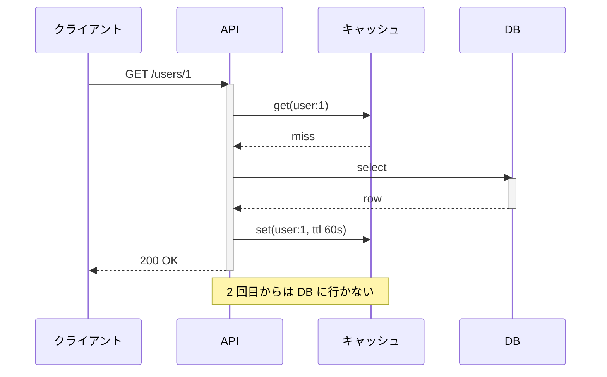
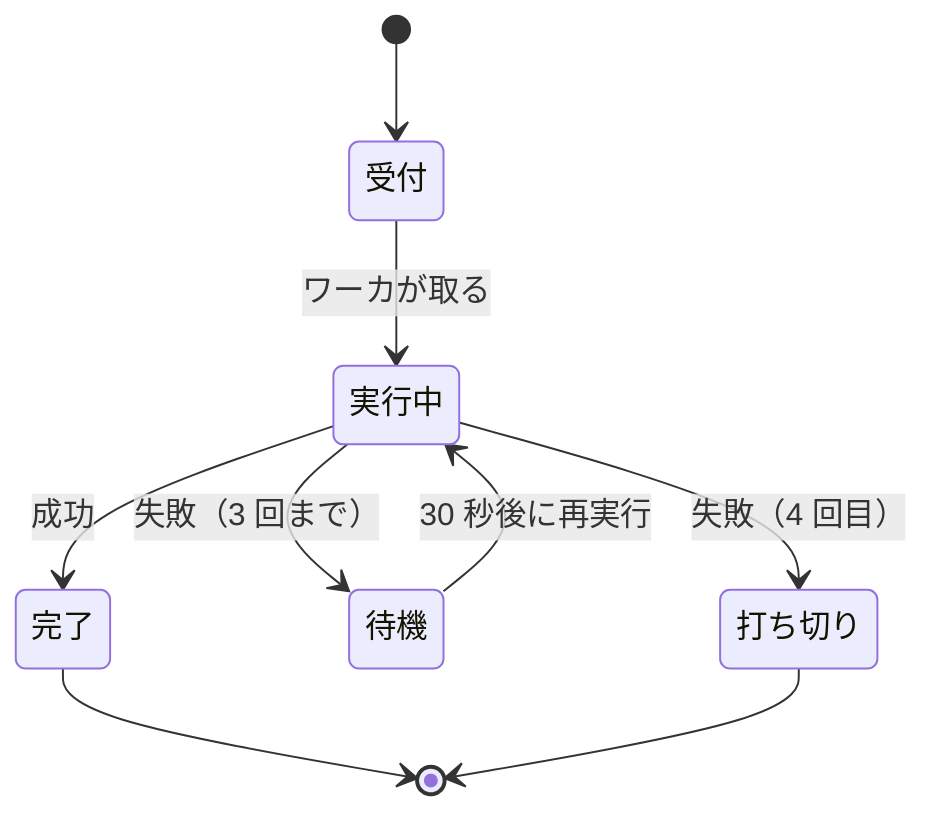

<!--
================================================================
 表紙
================================================================
 全面を絶対配置で組んでいる。置くものは 4 つだけ。

   枠      ... スライドの縁の内側に 1 本。消さない
   タイトル ... 左。上に寄せすぎず、縦の 1/3 あたりに置く
   イベント ... 右上。無いときは span ごと消す
   発表者   ... 左下。名前と日付

 ---- 枠 ------------------------------------------------------------
 スライドの地を薄い緑のグラデーションで塗り、内側 18px に白いパネルを載せている。
 外周の帯がそのまま枠になる。帯の幅は変えない。
 濃さを変えるなら styles/index.css の --c-cover-band を動かす。

 遊びの線は全面の <svg> にまとめてある。3 つだけ。
   ・左から入って渦を巻く線。帯をまたいで外から入ってくる
   ・右下と上の白い短い線。色帯の上に乗せて枠を切る
 増やさない。増やすと表紙が散らかる。

 ---- 題材のアイコン ------------------------------------------------
 タイトルの右、同じ高さに 1 つだけ置く。その回の題材をデフォルメしたもの。

   <div class="i-ph-tree-structure-fill w-[74px] h-[74px]" style="color: var(--c-accent-ink)"></div>

 ・塗りつぶしのアイコンを選ぶ。線画だと枠の中で痩せて見える
   ph の -fill 付き（i-ph-rocket-launch-fill など）が使いやすい
 ・logos の色付きロゴを入れるときは style の color を外す
 ・枠の大きさと位置は動かさない。タイトルと高さを揃えてある
 ・2 つ以上置かない

 ---- 風景 ----------------------------------------------------------
 右下にデフォルメした風景。画面のおよそ 3 割。
 ビルはアクセントの空色（--c-accent / --c-accent-deep / --c-accent-soft）、
 地面とアンテナは ink。名刺と同じ色づかいに揃えてある。
 右上がりにして左へ溶かす。左端はマスクで消しているので縦の切れ目ができない。

 グラデーションは <defs> にまとめてある。4 つだけ。
   cvGlow   右上のぼんやりした光。中心から外へ消える
   cvBack   奥のビル。下へ行くほど薄くなる
   cvFront  手前のビル。上から下へ濃くなる
   cvGround 地面。上が少し明るい
 色はすべて var(--c-*) を stop-color に入れている。直接の色コードを書かない。

 紙飛行機は小さいまま。後ろから見た形にして、奥へ飛んでいくように見せる。
 軌跡はくねくねさせて、根元が消えるグラデーション（cvTrail）をかけてある。
 向きは軌跡の終わりと揃える。角度を変えたら rotate の値も合わせる。

 差し替えるなら画像を public/ に置いて

   

 に入れ替える。
 サブタイトルは置かない。言いたいことはタイトル 1 行に収める。

 注意 2 つ。どちらも Vue のコンパイルが落ちる。
 ・HTML の開きタグは 1 行に収める。属性を改行でまたがない
 ・SVG の中に空行を入れない。空行で HTML ブロックが切れ、
   そのあとの深いインデントがコードブロック扱いになる
================================================================
-->

<div class="relative w-full h-full" style="background: linear-gradient(135deg, var(--c-accent-soft) 0%, var(--c-cover-band) 100%)">

  <div class="absolute inset-[18px] rounded-2xl overflow-hidden" style="background: var(--c-bg)">
    <div class="absolute inset-0 u-grid-paper" style="opacity: 0.9; -webkit-mask-image: linear-gradient(115deg, transparent 30%, #000 88%); mask-image: linear-gradient(115deg, transparent 30%, #000 88%)"></div>
  </div>

  <div class="absolute right-[18px] bottom-[18px] w-[690px] overflow-hidden" style="border-bottom-right-radius: 16px; -webkit-mask-image: linear-gradient(90deg, transparent 0%, #000 30%); mask-image: linear-gradient(90deg, transparent 0%, #000 30%)">
    <svg viewBox="0 0 580 280" class="w-full block">
      <defs>
        <radialGradient id="cvGlow">
          <stop offset="0" stop-color="var(--c-accent-soft)" />
          <stop offset="1" stop-color="var(--c-accent-soft)" stop-opacity="0" />
        </radialGradient>
        <linearGradient id="cvBack" x1="0" y1="0" x2="0" y2="1">
          <stop offset="0" stop-color="var(--c-accent-soft)" />
          <stop offset="1" stop-color="var(--c-accent-soft)" stop-opacity="0.3" />
        </linearGradient>
        <linearGradient id="cvFront" x1="0" y1="0" x2="0" y2="1">
          <stop offset="0" stop-color="var(--c-accent)" />
          <stop offset="1" stop-color="var(--c-accent-deep)" />
        </linearGradient>
        <linearGradient id="cvTrail" x1="0" y1="1" x2="1" y2="0">
          <stop offset="0" stop-color="var(--c-ink-3)" stop-opacity="0" />
          <stop offset="1" stop-color="var(--c-ink-3)" stop-opacity="1" />
        </linearGradient>
        <linearGradient id="cvGround" x1="0" y1="0" x2="0" y2="1">
          <stop offset="0" stop-color="var(--c-cover-band)" />
          <stop offset="1" stop-color="var(--c-accent)" />
        </linearGradient>
      </defs>
      <circle cx="486" cy="58" r="76" fill="url(#cvGlow)" />
      <path d="M104 234 C 140 220 130 190 164 178 C 198 166 188 142 216 132" stroke="url(#cvTrail)" stroke-width="2.5" stroke-dasharray="3 8" stroke-linecap="round" fill="none" />
      <g transform="translate(224 128) rotate(58)">
        <path d="M0 0 L-13 21 L0 14 L13 21 Z" fill="var(--c-ink-2)" />
        <path d="M0 0 L0 14" stroke="var(--c-bg)" stroke-width="1.2" fill="none" />
      </g>
      <rect x="296" y="176" width="44" height="80" rx="6" fill="url(#cvBack)" />
      <rect x="348" y="156" width="34" height="100" rx="6" fill="url(#cvBack)" />
      <rect x="390" y="140" width="50" height="116" rx="6" fill="url(#cvBack)" />
      <rect x="448" y="164" width="36" height="92" rx="6" fill="url(#cvBack)" />
      <rect x="492" y="132" width="46" height="124" rx="6" fill="url(#cvBack)" />
      <rect x="546" y="160" width="34" height="96" rx="6" fill="url(#cvBack)" />
      <path d="M365 156 V128" stroke="var(--c-ink)" stroke-width="2.5" stroke-linecap="round" />
      <circle cx="365" cy="124" r="5" fill="var(--c-ink)" />
      <path d="M515 132 V102" stroke="var(--c-ink)" stroke-width="2.5" stroke-linecap="round" />
      <circle cx="515" cy="98" r="5" fill="var(--c-ink)" />
      <path d="M365 128 C 412 160 470 150 515 104" stroke="var(--c-ink)" stroke-width="2" fill="none" stroke-linecap="round" />
      <rect x="318" y="200" width="48" height="60" rx="6" fill="url(#cvFront)" />
      <rect x="374" y="182" width="40" height="78" rx="6" fill="url(#cvFront)" />
      <rect x="422" y="192" width="56" height="68" rx="6" fill="url(#cvFront)" />
      <rect x="486" y="170" width="42" height="90" rx="6" fill="url(#cvFront)" />
      <rect x="536" y="186" width="38" height="74" rx="6" fill="url(#cvFront)" />
      <g fill="var(--c-bg)">
        <rect x="328" y="212" width="9" height="9" rx="2" />
        <rect x="345" y="212" width="9" height="9" rx="2" />
        <rect x="328" y="230" width="9" height="9" rx="2" />
        <rect x="384" y="196" width="9" height="9" rx="2" />
        <rect x="397" y="196" width="9" height="9" rx="2" />
        <rect x="384" y="214" width="9" height="9" rx="2" />
        <rect x="434" y="206" width="9" height="9" rx="2" />
        <rect x="451" y="206" width="9" height="9" rx="2" />
        <rect x="434" y="224" width="9" height="9" rx="2" />
        <rect x="496" y="184" width="9" height="9" rx="2" />
        <rect x="509" y="184" width="9" height="9" rx="2" />
        <rect x="496" y="202" width="9" height="9" rx="2" />
        <rect x="546" y="200" width="9" height="9" rx="2" />
        <rect x="559" y="200" width="9" height="9" rx="2" />
      </g>
      <rect x="451" y="224" width="9" height="9" rx="2" fill="var(--c-accent-soft)" />
      <rect x="509" y="202" width="9" height="9" rx="2" fill="var(--c-accent-soft)" />
      <rect x="402" y="230" width="4" height="13" rx="1.5" fill="var(--c-bg)" />
      <path d="M0 262 C 140 256 300 244 420 236 C 500 231 540 229 580 228 L580 280 L0 280 Z" fill="url(#cvGround)" />
    </svg>
  </div>

  <div class="absolute right-16 top-16 u-12 u-faint">イベント名</div>

  <div class="absolute left-16 top-[29%]">

# タイトル

  </div>

  <div class="absolute right-[120px] top-[124px] w-[132px] h-[132px] flex items-center justify-center">
    <div class="i-ph-tree-structure-fill w-[104px] h-[104px]" style="color: var(--c-accent-ink)"></div>
  </div>

  <div class="absolute left-16 bottom-16 flex items-baseline gap-6 u-12 u-faint">
    <span>発表者</span>
    <span>YYYY/MM/DD</span>
  </div>

</div>

---
hideInToc: true
---

<!--
================================================================
 目次
================================================================

 <Toc /> がスライドの見出しから自動で作る。手で項目を書かない。

 ---- 目次に出す / 出さない --------------------------------------
 フロントマターに hideInToc: true を書いたスライドは目次に出ない。
 表紙・目次そのもの・章の中身のスライドには付けておく。
 目次に出るのは layout: section の章扉だけ、という状態を保つ。

 ---- Toc の主なオプション ----------------------------------------
   minDepth / maxDepth  見出しレベルの範囲。章扉だけなら 1 と 1
   columns              段組みの数。項目が増えたら 2 にする
   mode                 all（既定） / onlyCurrentTree / onlySiblings

 番号は styles/index.css の counter で振っている。ここには書かない。
================================================================
-->

# 目次

<Toc minDepth="1" maxDepth="1" class="mt-8" />

---
layout: section
---

# 自己紹介

---
hideInToc: true
---

<!--
================================================================
 自己紹介
================================================================
 名刺と同じ作り。空色の面、方眼紙、細くて字間の広いラテン。
 手描きの線は使わない。

 ---- 置き方 --------------------------------------------------------
 左  肩書き → 名前 → ローマ字 → ラベル + 内容 の 5 行
 右  丸い顔だけ。後ろに面を敷かない

 見出しは「自己紹介」ではなく名前そのもの。章扉が直前で名乗っているので
 ここで繰り返さない。

 ---- ラテン --------------------------------------------------------
 Space Grotesk の 300。字間を 0.3em まで開ける。
 太字にしない。細くて広いから名刺の空気になる。

 ---- 大きさの付け方 ------------------------------------------------
 名刺と同じで「小さい → 大きい」の落差で見せる。
   肩書き   12px  細いラテン。名前の前に小さく置く
   名前     36px  ここだけ重い。1 枚の主役
   ローマ字 20px  細くて広い。名前を受ける
   ラベル   12px  空色の濃い方。内容の上に置く
   内容     20px  客席から読める大きさ。ラベルより少し右へ下げる
 12 と 36 を隣に置くのが効く。中間のサイズで埋めない。

 ---- 右 ------------------------------------------------------------
 丸い顔を 1 つ置くだけ。後ろに面や図形を敷かない。地の方眼に直接置く。
 高さはスライドの上下中央。top の値はそれに合わせた実測値なので、
 名前の行数を変えたら中央に戻るよう取り直す。
 写真にするときは枠の中のコメントの img を出してアイコンの div を消す。
 写真は正方形。

 ---- 5 つの項目 ----------------------------------------------------
 出身地 / 経歴 / 長所 / 趣味 / 最近 の順で固定。
 ラベルを上、その少し右下に内容を置く。横に並べない。
 ラベルは 12px の空色の濃い方。内容は 20px の黒。
 内容は短い 1 文でよい。ただし 1 行に収める。
 折り返すと 5 つ入らなくなるので、入らないなら文を削る。

 ---- 動き ----------------------------------------------------------
 v-motion で自動。顔 → ローマ字 → 5 行 の順。
 delay は 80 / 170 / 300 / 420 / 490 / 560 / 630 / 700。
 肩書きは h1 の直前に普通に流して置く。絶対配置にすると h1 に重なる。
================================================================
-->

<div class="u-12 mb-1" style="font-family: 'Space Grotesk', sans-serif; font-weight: 300; letter-spacing: 0.3em; color: var(--c-accent-ink)">SOFTWARE ENGINEER</div>

# なまえ

<div class="relative h-[400px] -mt-2">
  <div class="absolute left-0 top-[2px] u-20" style="font-family: 'Space Grotesk', sans-serif; font-weight: 300; letter-spacing: 0.3em; color: var(--c-ink-2)" v-motion :initial="{ y: 12, opacity: 0 }" :enter="{ y: 0, opacity: 1, transition: { delay: 170, duration: 620 } }">NAMAE MYOJI</div>
  <div class="absolute left-0 top-[78px] w-[510px] flex flex-col gap-3">
    <div v-motion :initial="{ y: 10, opacity: 0 }" :enter="{ y: 0, opacity: 1, transition: { delay: 420, duration: 560 } }">
      <div class="u-12" style="color: var(--c-accent-ink); letter-spacing: 0.14em">出身地</div>
      <div class="u-20 pl-7" style="margin-top: 1px">○○県○○市 海の近くで育ちました</div>
    </div>
    <div v-motion :initial="{ y: 10, opacity: 0 }" :enter="{ y: 0, opacity: 1, transition: { delay: 490, duration: 560 } }">
      <div class="u-12" style="color: var(--c-accent-ink); letter-spacing: 0.14em">経歴</div>
      <div class="u-20 pl-7" style="margin-top: 1px">○○で○年、いまは○○をやっています</div>
    </div>
    <div v-motion :initial="{ y: 10, opacity: 0 }" :enter="{ y: 0, opacity: 1, transition: { delay: 560, duration: 560 } }">
      <div class="u-12" style="color: var(--c-accent-ink); letter-spacing: 0.14em">長所</div>
      <div class="u-20 pl-7" style="margin-top: 1px">手を動かしながら考えるのが得意です</div>
    </div>
    <div v-motion :initial="{ y: 10, opacity: 0 }" :enter="{ y: 0, opacity: 1, transition: { delay: 630, duration: 560 } }">
      <div class="u-12" style="color: var(--c-accent-ink); letter-spacing: 0.14em">趣味</div>
      <div class="u-20 pl-7" style="margin-top: 1px">○○と○○ 最近は○○にはまっています</div>
    </div>
    <div v-motion :initial="{ y: 10, opacity: 0 }" :enter="{ y: 0, opacity: 1, transition: { delay: 700, duration: 560 } }">
      <div class="u-12" style="color: var(--c-accent-ink); letter-spacing: 0.14em">最近</div>
      <div class="u-20 pl-7" style="margin-top: 1px">○○をさわって仕組みを追っています</div>
    </div>
  </div>
  <div class="absolute right-[76px] top-[24px] w-[250px] h-[250px] rounded-full overflow-hidden flex items-center justify-center" style="background: var(--c-accent)" v-motion :initial="{ y: 34, opacity: 0 }" :enter="{ y: 0, opacity: 1, transition: { delay: 80, type: 'spring', stiffness: 190, damping: 18 } }">
    <!-- 写真にするなら、下の 1 行をこれに置き換える -->
    <!--  -->
    <div class="i-ph-user-fill w-[132px] h-[132px]" style="color: var(--c-bg)"></div>
  </div>
</div>

---
layout: section
---

# 文字

---
hideInToc: true
---

<!--
================================================================
 文字の書き方
================================================================

 ---- 文章 --------------------------------------------------------
 **文字数を減らす。** 1 行は画面幅の 6 割まで。全角でおよそ 33 字。
 CSS では止めていない。書くときに削る。
 削れないときだけ折り返す。折り返しは最後の手段。
 長い文は読みづらく、書きづらく、意図が伝わらない。スライドに向かない。
 説明が要るなら発表者ノートに書く。

 ---- 大きさ ------------------------------------------------------
 見出しは 3 段階。h1 36px / h2 24px / h3 20px。h4 以下は使わない。
 本文は 4 段階。u-20 / 本文 18px / u-16 / u-12。
 18px が基準なので、普通に書けば 18px になる。
 この 7 つ以外のサイズを slides.md に書かない。
 入りきらないのは情報が多すぎるサイン。

 ---- 置き方 ------------------------------------------------------
 見出しは 3 段階まで。h4 以下は使わない。
 h1 の直後の段落は自動でリード文になる。
 1 枚に h2 は 2 つまで。

 ---- 箇条書き ----------------------------------------------------
 4 項目まで、階層は 2 段まで。句で止める。語尾を揃える。

 ---- 強調 --------------------------------------------------------
 太字は 1 枚に 2 箇所まで。色では強調しない。
================================================================
-->

# 大きさ

見出し 3 段階、本文 4 段階

<div class="mt-6 flex flex-col gap-4">
  <div class="flex items-baseline gap-8">
    <span class="w-32 shrink-0 u-12 u-faint">h1 · 36px</span>
    <h1 class="!m-0">見出し</h1>
  </div>
  <div class="flex items-baseline gap-8">
    <span class="w-32 shrink-0 u-12 u-faint">h2 · 24px</span>
    <h2 class="!m-0">中見出し</h2>
  </div>
  <div class="flex items-baseline gap-8">
    <span class="w-32 shrink-0 u-12 u-faint">h3 · 20px</span>
    <h3 class="!m-0">小見出し</h3>
  </div>
  <div class="flex items-baseline gap-8">
    <span class="w-32 shrink-0 u-12 u-faint">u-20</span>
    <p class="!m-0 u-20">強調したい一文</p>
  </div>
  <div class="flex items-baseline gap-8">
    <span class="w-32 shrink-0 u-12 u-faint">本文 · 18px</span>
    <p class="!m-0">本文はこの大きさ</p>
  </div>
  <div class="flex items-baseline gap-8">
    <span class="w-32 shrink-0 u-12 u-faint">u-16</span>
    <p class="!m-0 u-16">少し落とす文</p>
  </div>
  <div class="flex items-baseline gap-8">
    <span class="w-32 shrink-0 u-12 u-faint">u-12</span>
    <p class="!m-0 u-12">注釈はこの大きさ</p>
  </div>
</div>

---
hideInToc: true
---

<!--
================================================================
 箇条書き
================================================================
 書き方の決まりをそのままページにしてある。

 MEMO: 4 項目まで・階層 2 段まで・句で止める・語尾を揃える、は
        どれも AI が決めた上限。守りやすいかどうかは使ってみてから。
        番号付きを「順番に意味があるときだけ」に限るのも同じ。
================================================================
-->

# 箇条書き

- 4 項目まで
- 階層は 2 段まで
  - 2 段目はここまで
- 句で止める
- 語尾を揃える

### 番号付き {.mt-8}

1. 順番に意味があるときだけ
2. 手順や優先順位

---
hideInToc: true
---

<!--
================================================================
 表
================================================================
 対応状況や設定値のように、**同じ項目を何本も比べる**ときだけ使う。
 2 列しかないなら表にしない。ラベルと内容を縦に並べた方が読める。

 ---- 作り ----------------------------------------------------------
 Markdown の表をそのまま書けば、styles/index.css が形を付ける。
 **罫を 1 本も引かない。** 行の区切りは余白で出している。
 線で囲うと、そこだけ別の資料から貼ってきたように見える。

 見出しは 12px の空色。本文より小さくして、読む順を下に送る。
 幅は中身に合わせて縮む。画面いっぱいに広げない。

 ---- 大きさ --------------------------------------------------------
 **4 列 5 行まで。** それ以上は客席から読めない。
 多いときは行を減らすか、2 枚に分ける。列は増やさない。

 ---- 書き方 --------------------------------------------------------
 セルは 1 行。折り返したら文が長すぎる。
 数字の列は単位をそろえて、見出しに単位を書く。セルには数字だけ。
 空欄は「−」で埋める。空のままだと抜けなのか無しなのか分からない。
 MEMO: 4 列 5 行という上限も、空欄を「−」で埋めるのも AI が決めた。
        表を使う場面を見てから詰め直したい。
================================================================
-->

# 表

| 項目 | いままで | これから | 備考 |
| --- | --- | --- | --- |
| 実行環境 | ○○ | ○○ | 移行済み |
| 設定の持ち方 | ○○ | ○○ | − |
| 失敗したとき | ○○ | ○○ | 手順を更新 |
| 必要な権限 | ○○ | ○○ | − |

---
hideInToc: true
---

<!--
================================================================
 強調と引用
================================================================
 太字・コード・リンク・引用の使い分けを 1 枚にまとめてある。

 ---- 罫を引かない --------------------------------------------------
 引用は字下げだけ、文中のコードは等幅の字面だけ、リンクは空色の文字だけ。
 どれも styles/index.css で資料全体に効いている。ページ側では何もしない。

 MEMO: リード文の「使い分けだけ決める」はページの説明に近い書き方で、
        他の型では禁じている形。文字の章は仕様ページなので残しているが、
        ここも書き換えるかは未確認。
================================================================
-->

# 強調と引用

使い分けだけ決める

太字は **1 枚に 2 箇所まで** 色では強調しない

コマンドは `slides.md` 参照は [リンク](https://sli.dev)

> 引用はこの形

<div class="mt-6 u-muted">補足は <code>u-muted</code> で落とす</div>

---
layout: section
---

# 発表の型

---
hideInToc: true
---

<!--
================================================================
 発表の型
================================================================
 本番でよく使う並べ方を 5 つ置いてある。中身を差し替えて使う。
 課題 → 比較 → 手順 → まとめ → 質疑。

 ---- イラストの入れ方 ----------------------------------------------
 大きく見せたいときは Loose Drawing の素材。

   <Illust src="/illust/error-trouble.png" :w="300" />

 素材の一覧は public/illust/README.md。既定で空色に寄せて出る。

 小さいアイコンは @iconify-json/tabler（MIT・6286 個）。クラスで呼ぶだけ。

   <div class="i-tabler-target-arrow w-12 h-12" style="color: var(--c-ink)"></div>

 ・文中や見出しの横に置くなら 32〜48px
 ・そのページの主役にするなら 96〜128px
 ・140px を超えると線が太くなりすぎる。そこからは Illust を使う
 ・色は var(--c-ink) か var(--c-accent-ink)。2 色以上使わない
 ・名前は https://tabler.io/icons で探す

 絵は Loose Drawing の素材だけを使う。自前の線画は持っていない。
 太さが違うので、同じページで tabler と Illust を混ぜない。
 MEMO: 3 点の箇条書き・右にイラスト、という形は AI が置いたもの。
        課題を 3 つに絞るのが妥当かは、実際の発表で試してから。
================================================================
-->

# 課題

<Illust src="/illust/error-trouble.png" :w="300" />

いまの○○は○○で止まっている

- ○○に時間がかかる
- ○○が属人化している
- ○○が見えない

---
hideInToc: true
---

<!--
================================================================
 タイムライン
================================================================
 左から右へ時間が進む。4 列で固定。
 **時間の型のなかで、節目ごとに長い説明を置けるのはこの型だけ。**
 1 列は 日付 → 点 → 見出し → 一行 → 補足、の 5 段。

 ・日付は 12px の空色。YYYY.MM で揃える
 ・点は線の上に乗る。線の位置は top で合わせてあるので動かさない
 ・最後の点だけ ink にして少し大きくする。いまここ、を示す
 ・見出しは短く。2〜4 文字に収めないと列から溢れる
 ・一行（16px）は何をしたか。補足（12px・薄墨）はどう決めたか
 ・5 列以上にしない。文字が小さくなって読めない

 ---- 補足の長さ ----------------------------------------------------
 1 列は約 200px。12px なら 1 行 16 文字で、6 行まで入る。
 **1 列あたり 90 文字まで。** 4 列ぶんで 360 文字になるので、
 全部を埋めない。**本当に説明が要る節目だけ書く。** 他は空でよい。

 **1 文につき div を 1 つ。** 句点を使わない決まりなので、
 文を切るときは段落を分ける。1 つの div に 2 文を詰めると読点だらけになる。

 7 行を超えると下が切れる。削るか、その節目だけ別の 1 枚に起こす。

 ---- 節目が 5 つ以上のとき ------------------------------------------
 年表（上下に振り分け）か経緯（縦）に移す。
 ただしどちらも補足は 1 行ぶんしか置けない。
 **長い説明を残したいなら、節目を 4 つに絞ってこの型に留める。**
================================================================
-->

# タイムライン

<div class="relative mt-10">
  <div class="absolute left-[8px] right-[8px] h-[2px]" style="top: 29px; background: var(--c-border-strong)"></div>
  <div class="relative grid grid-cols-4" style="column-gap: 32px">
  <div>
    <div class="u-12" style="color: var(--c-accent-ink); letter-spacing: 0.12em">2024.04</div>
    <div class="w-4 h-4 rounded-full my-[2px]" style="background: var(--c-accent)"></div>
    <div class="u-20 font-bold mt-3">着手</div>
    <div class="u-16 mt-2">○○を調べはじめた</div>
    <div class="u-12 u-muted mt-3 leading-relaxed">○○が○○だと分かったので、まず○○を測るところから始めた</div>
    <div class="u-12 u-muted mt-2 leading-relaxed">○○は後回しにして、○○だけに絞っている</div>
  </div>
  <div>
    <div class="u-12" style="color: var(--c-accent-ink); letter-spacing: 0.12em">2024.07</div>
    <div class="w-4 h-4 rounded-full my-[2px]" style="background: var(--c-accent)"></div>
    <div class="u-20 font-bold mt-3">試作</div>
    <div class="u-16 mt-2">○○で動くものを作った</div>
    <div class="u-12 u-muted mt-3 leading-relaxed">○○だけを○○に置き換えて 2 週間回した</div>
    <div class="u-12 u-muted mt-2 leading-relaxed">全部を一度に替えないのは、戻せる範囲を小さく保つため</div>
  </div>
  <div>
    <div class="u-12" style="color: var(--c-accent-ink); letter-spacing: 0.12em">2024.11</div>
    <div class="w-4 h-4 rounded-full my-[2px]" style="background: var(--c-accent)"></div>
    <div class="u-20 font-bold mt-3">導入</div>
    <div class="u-16 mt-2">○○に入れて回しはじめた</div>
    <div class="u-12 u-muted mt-3 leading-relaxed">先に○○チームだけに入れ、○○は外したまま様子を見た</div>
    <div class="u-12 u-muted mt-2 leading-relaxed">問い合わせが○○件で収まったので次へ進めた</div>
  </div>
  <div>
    <div class="u-12" style="color: var(--c-accent-ink); letter-spacing: 0.12em">2025.03</div>
    <div class="w-[20px] h-[20px] rounded-full my-[1px]" style="background: var(--c-ink)"></div>
    <div class="u-20 font-bold mt-3">いま</div>
    <div class="u-16 mt-2">○○を広げている</div>
    <div class="u-12 u-muted mt-3 leading-relaxed">手順を○○に書き出して渡し、3 チームで回している</div>
    <div class="u-12 u-muted mt-2 leading-relaxed">○○はまだ手で見ているので、ここを次に自動にする</div>
  </div>
  </div>
</div>

---
hideInToc: true
---

<!--
================================================================
 年表（上下に振り分けるタイムライン）
================================================================
 節目が 7 つくらいあって、**横に並べたい**ときの型。
 横のタイムラインは 4 列で頭打ちだが、上下に振り分ければ倍入る。

 ---- 組み方 --------------------------------------------------------
 画面の縦の真ん中に線を 1 本。点はその上に乗る。
 奇数番目を線の上、偶数番目を下に置く。

 ---- なぜ上下に振り分けるか ----------------------------------------
 **文章の幅を倍にするため。** 7 つを横に並べると 1 列 120px しか取れないが、
 上下に振り分ければ、隣り合う節目は反対側に逃げる。
 だから箱の幅を節目の間隔の倍近く（186px）まで広げられる。
 上の箱どうしは 236px 離れているので、186px なら 50px の余白が残る。

 これが**この型の唯一の仕掛け**で、他に飾りは足さない。
 年を線の上に大きく置くのも試したが、線が読みにくくなるのでやめた。

 ---- 寸法 ----------------------------------------------------------
 全部 absolute で置いている。数字は連動しているので、1 つだけ動かさない。

   点     x = 149 + 118 × n      n は 0 から 6
   線     top: 212px
   足     26px。点の上か下に伸ばす
   箱     幅 186px。点を中心に左右へ 93px
   高さ   430px

 同じ側の箱どうしは 236px 離れているので、箱の間に 50px の余白が空く。
 **ここを詰めない。** 隣とくっつくと、どの点の説明なのか分からなくなる。

 ---- 線の長さ ------------------------------------------------------
 **線は文章の幅に合わせる。** 左端は 1 つ目の箱の左、右端は最後の箱の右。
 画面の端まで伸ばすと、点も文字も無い所に線だけが残って浮く。
 点の間隔や箱の幅を変えたら、この left / right も計算し直す。

 **箱の幅を広げるなら、点の間隔も一緒に広げる。** 間隔 × 2 より狭く保つ。
 点は足のあとに描く。先に描くと足の線が点の上に乗る。

 ---- 書き方 --------------------------------------------------------
 日付は 12px の空色、見出しは 20px。
 **補足は 1 列 75 文字まで。** 1 行 15 文字で 5 行くらい。
 1 文につき div を 1 つ。句点を使わない決まりなので、文を切るなら段落を分ける。
 **全部の節目を埋めない。** 説明が要る所だけ書いて、他は見出しだけで止める。

 7 つを超えると箱が重なる。超えたら経緯（縦）に移す。

 MEMO: 「年表」という名前は自分で決めた。経緯・期間・経過と並べたときに
       読み分けられる語を選んだが、しっくり来ていない。
       横長で点が多い、という性質が伝わる名前なら何でもよい。
================================================================
-->

# 年表

<div class="u-bleed relative mt-4" style="height: 430px">
  <div class="absolute h-[2px]" style="left: 56px; width: 690px; top: 212px; background: var(--c-border-strong)"></div>
  <div class="absolute w-[2px]" style="left: 55px; top: 186px; height: 26px; background: var(--c-border-strong)"></div>
  <div class="absolute rounded-full" style="left: 56px; top: 212px; transform: translate(-50%, -50%); border: 3px solid var(--c-accent); background: var(--c-bg); width: 15px; height: 15px"></div>
  <div class="absolute" style="left: 56px; width: 178px; bottom: 244px"><div class="u-12" style="color: var(--c-accent-ink); letter-spacing: 0.12em">2023.04</div><div class="u-20 font-bold mt-1">着手</div><div class="u-12 u-muted mt-3 leading-relaxed">○○が遅いという声が続いた</div><div class="u-12 u-muted mt-3 leading-relaxed">直す前に 1 週間ぶん測った</div></div>
  <div class="absolute w-[2px]" style="left: 170px; top: 214px; height: 26px; background: var(--c-border-strong)"></div>
  <div class="absolute rounded-full" style="left: 171px; top: 212px; transform: translate(-50%, -50%); border: 3px solid var(--c-accent); background: var(--c-bg); width: 15px; height: 15px"></div>
  <div class="absolute" style="left: 171px; width: 178px; top: 238px"><div class="u-12" style="color: var(--c-accent-ink); letter-spacing: 0.12em">2023.08</div><div class="u-20 font-bold mt-1">試作</div><div class="u-12 u-muted mt-3 leading-relaxed">○○だけを 2 週間置き換えた</div><div class="u-12 u-muted mt-3 leading-relaxed">他は触らずに残した</div></div>
  <div class="absolute w-[2px]" style="left: 285px; top: 186px; height: 26px; background: var(--c-border-strong)"></div>
  <div class="absolute rounded-full" style="left: 286px; top: 212px; transform: translate(-50%, -50%); border: 3px solid var(--c-accent); background: var(--c-bg); width: 15px; height: 15px"></div>
  <div class="absolute" style="left: 286px; width: 178px; bottom: 244px"><div class="u-12" style="color: var(--c-accent-ink); letter-spacing: 0.12em">2023.12</div><div class="u-20 font-bold mt-1">社内導入</div><div class="u-12 u-muted mt-3 leading-relaxed">1 チームにだけ入れた</div><div class="u-12 u-muted mt-3 leading-relaxed">問い合わせは○件で収まった</div></div>
  <div class="absolute w-[2px]" style="left: 400px; top: 214px; height: 26px; background: var(--c-border-strong)"></div>
  <div class="absolute rounded-full" style="left: 401px; top: 212px; transform: translate(-50%, -50%); border: 3px solid var(--c-accent); background: var(--c-bg); width: 15px; height: 15px"></div>
  <div class="absolute" style="left: 401px; width: 178px; top: 238px"><div class="u-12" style="color: var(--c-accent-ink); letter-spacing: 0.12em">2024.04</div><div class="u-20 font-bold mt-1">本番</div><div class="u-12 u-muted mt-3 leading-relaxed">夜に○○ずつ切り替えた</div></div>
  <div class="absolute w-[2px]" style="left: 515px; top: 186px; height: 26px; background: var(--c-border-strong)"></div>
  <div class="absolute rounded-full" style="left: 516px; top: 212px; transform: translate(-50%, -50%); border: 3px solid var(--c-accent); background: var(--c-bg); width: 15px; height: 15px"></div>
  <div class="absolute" style="left: 516px; width: 178px; bottom: 244px"><div class="u-12" style="color: var(--c-accent-ink); letter-spacing: 0.12em">2024.09</div><div class="u-20 font-bold mt-1">3 チーム</div></div>
  <div class="absolute w-[2px]" style="left: 630px; top: 214px; height: 26px; background: var(--c-border-strong)"></div>
  <div class="absolute rounded-full" style="left: 631px; top: 212px; transform: translate(-50%, -50%); border: 3px solid var(--c-accent); background: var(--c-bg); width: 15px; height: 15px"></div>
  <div class="absolute" style="left: 631px; width: 178px; top: 238px"><div class="u-12" style="color: var(--c-accent-ink); letter-spacing: 0.12em">2025.01</div><div class="u-20 font-bold mt-1">全社</div><div class="u-12 u-muted mt-3 leading-relaxed">残っていた○○も移した</div></div>
  <div class="absolute w-[2px]" style="left: 745px; top: 186px; height: 26px; background: var(--c-border-strong)"></div>
  <div class="absolute rounded-full" style="left: 746px; top: 212px; transform: translate(-50%, -50%); background: var(--c-ink); width: 21px; height: 21px"></div>
  <div class="absolute" style="left: 746px; width: 178px; bottom: 244px"><div class="u-12" style="color: var(--c-accent-ink); letter-spacing: 0.12em">2025.03</div><div class="u-20 font-bold mt-1">いま</div><div class="u-12 u-muted mt-3 leading-relaxed">○○はまだ手で見ている</div><div class="u-12 u-muted mt-3 leading-relaxed">次はここを自動にする</div></div>
</div>

---
hideInToc: true
---

<!--
================================================================
 経緯（縦のタイムライン）
================================================================
 横のタイムラインに入りきらないときに使う。**5 つ以上なら縦。**
 横は 4 列で頭打ちなので、そこを超えたらこちらに切り替える。

 ---- 組み方 --------------------------------------------------------
 左に日付（12px・空色・幅 72px で固定）、右に見出し。1 行に収める。
 日付の下に見出しを置くと 6 行で画面から溢れる。
 線は左端に 1 本。色は --c-border-strong。アクセント色にしない。
 **方眼のトークンを使わない。** 地の線と同じ濃さだと、軸が紙の罫に紛れる。
 **点は線の上に乗る。** left と線の位置をそろえてあるので動かさない。

 最後の 1 つだけ点を ink にして大きくする。いまここ、を示す。
 横のタイムラインと同じ作法にそろえてある。

 ---- 書き方 --------------------------------------------------------
 7 行まで。それ以上は入らないので、期間を区切って 2 枚に分ける。
 見出しは 2〜12 文字。説明を足したくなったら、その回だけ別の型にする。
 **日付の粒度をそろえる。** 月と日が混ざると、どこが山場か読めない。

 MEMO: 縦線を 1 本引いている。「罫は引かない」という方針の例外。
       横のタイムラインに線があるので、縦も同じ作りにそろえた。
       点だけ並べて線を消す案もあるが、ただの箇条書きに見えた。
================================================================
-->

# 経緯

<div class="relative mt-10 pl-9">
  <div class="absolute top-[10px] bottom-[10px] w-[2px]" style="left: 7px; background: var(--c-border-strong)"></div>
  <div class="flex flex-col gap-7">
    <div class="relative flex items-baseline gap-7"><div class="absolute w-4 h-4 rounded-full" style="left: -36px; top: 5px; background: var(--c-accent)"></div><div class="u-12 shrink-0 w-[72px]" style="color: var(--c-accent-ink); letter-spacing: 0.12em">2024.04</div><div class="u-20 font-bold">調べはじめた</div></div>
    <div class="relative flex items-baseline gap-7"><div class="absolute w-4 h-4 rounded-full" style="left: -36px; top: 5px; background: var(--c-accent)"></div><div class="u-12 shrink-0 w-[72px]" style="color: var(--c-accent-ink); letter-spacing: 0.12em">2024.06</div><div class="u-20 font-bold">手元で動かした</div></div>
    <div class="relative flex items-baseline gap-7"><div class="absolute w-4 h-4 rounded-full" style="left: -36px; top: 5px; background: var(--c-accent)"></div><div class="u-12 shrink-0 w-[72px]" style="color: var(--c-accent-ink); letter-spacing: 0.12em">2024.09</div><div class="u-20 font-bold">社内の 1 チームで使った</div></div>
    <div class="relative flex items-baseline gap-7"><div class="absolute w-4 h-4 rounded-full" style="left: -36px; top: 5px; background: var(--c-accent)"></div><div class="u-12 shrink-0 w-[72px]" style="color: var(--c-accent-ink); letter-spacing: 0.12em">2024.11</div><div class="u-20 font-bold">本番に入れた</div></div>
    <div class="relative flex items-baseline gap-7"><div class="absolute w-4 h-4 rounded-full" style="left: -36px; top: 5px; background: var(--c-accent)"></div><div class="u-12 shrink-0 w-[72px]" style="color: var(--c-accent-ink); letter-spacing: 0.12em">2025.01</div><div class="u-20 font-bold">3 チームに広げた</div></div>
    <div class="relative flex items-baseline gap-7"><div class="absolute w-[18px] h-[18px] rounded-full" style="left: -37px; top: 4px; background: var(--c-ink)"></div><div class="u-12 shrink-0 w-[72px]" style="color: var(--c-accent-ink); letter-spacing: 0.12em">2025.03</div><div class="u-20 font-bold">いま</div></div>
  </div>
</div>

<Illust src="/illust/data-forecast.png" :w="250" />

---
hideInToc: true
---

<!--
================================================================
 期間（ガント風）
================================================================
 **同時に走っていたこと**を見せる。点の時系列では重なりが出せない。
 「設計が終わる前に実装を始めていた」のような話はこの型でしか出せない。

 ---- 組み方 --------------------------------------------------------
 grid を使う。1 列目が名前、残りが月。
 **名前の div に grid-column: 1 を必ず書く。** 書かないと、
 前の帯が終わった列から流し込まれて、行がずれる。
 帯は style の grid-column で始まりと終わりを決める。
   grid-column: 2 / 5   2 列目から 5 列目の手前まで（4〜6 月）
 **月は 6 つまで。** それ以上は 1 月あたりが細くなって帯が読めない。

 ---- 色 ------------------------------------------------------------
 終わったものは空色、いま動いているものだけ ink。
 **角を丸めない。** 直角の帯にそろえる。
 帯の中に文字を入れない。名前は左に出してある。

 ---- 書き方 --------------------------------------------------------
 行は 5 本まで。横に伸ばさず、関係ないものは落とす。
 期間が 1 月しかないものは帯が細くて読めないので、点の時系列に回す。
================================================================
-->

# 期間

<div class="mt-10 grid items-center gap-y-6" style="grid-template-columns: 170px repeat(6, 1fr); column-gap: 4px">
  <div></div>
  <div class="u-12" style="color: var(--c-accent-ink); letter-spacing: 0.12em">10月</div>
  <div class="u-12" style="color: var(--c-accent-ink); letter-spacing: 0.12em">11月</div>
  <div class="u-12" style="color: var(--c-accent-ink); letter-spacing: 0.12em">12月</div>
  <div class="u-12" style="color: var(--c-accent-ink); letter-spacing: 0.12em">1月</div>
  <div class="u-12" style="color: var(--c-accent-ink); letter-spacing: 0.12em">2月</div>
  <div class="u-12" style="color: var(--c-accent-ink); letter-spacing: 0.12em">3月</div>
  <div class="u-16" style="grid-column: 1">調査と設計</div>
  <div class="h-7" style="grid-column: 2 / 4; background: var(--c-accent)"></div>
  <div class="u-16" style="grid-column: 1">実装</div>
  <div class="h-7" style="grid-column: 3 / 6; background: var(--c-accent)"></div>
  <div class="u-16" style="grid-column: 1">移行</div>
  <div class="h-7" style="grid-column: 5 / 7; background: var(--c-accent)"></div>
  <div class="u-16" style="grid-column: 1">他チームへ</div>
  <div class="h-7" style="grid-column: 6 / 8; background: var(--c-ink)"></div>
</div>

<div class="mt-12 u-20">設計が終わる前に実装を始めている</div>
<div class="mt-2 u-16 u-muted">動くものを先に置いたら、設計で迷っていた所が決まった</div>

---
hideInToc: true
---

<!--
================================================================
 経過（分刻みのタイムライン）
================================================================
 障害対応や当日の動きのように、**分の単位で追う**ときの型。
 年月のタイムラインとは別もので、1 枚で 1 時間ぶんくらいを扱う。

 ---- 組み方 --------------------------------------------------------
 2 列。時刻（12px・等幅）と、できごと。
 時刻は font-mono を当てて桁をそろえる。ずれると目が止まる。
 **できごとは事実だけ。** 「焦った」「大変だった」を書かない。

 ---- 強弱 ----------------------------------------------------------
 復旧した行だけ墨の太字、他は薄墨。節目が 1 行だけ浮く。
 原因が分かった行に 12px で一言添えると、あとで読み返せる。
 **添える 12px は u-muted。** u-faint だと白地に対して薄すぎて読めない。

 ---- 一番下 --------------------------------------------------------
 検知から復旧までの合計を必ず出す。**ここがこのページの数字。**
 出さないと、速かったのか遅かったのかが伝わらない。

 ---- 書き方 --------------------------------------------------------
 6 行まで。全部は書けないので、判断が変わった所だけ残す。
 復旧後の再発防止は別の型（落とし穴・手順）に回す。
================================================================
-->

# 経過

<div class="mt-10 grid gap-y-5" style="grid-template-columns: 110px 1fr; max-width: 820px">
  <div class="u-12 font-mono u-faint" style="padding-top: 6px">14:02</div>
  <div class="u-20 u-muted">アラートが鳴る</div>
  <div class="u-12 font-mono u-faint" style="padding-top: 6px">14:05</div>
  <div class="u-20 u-muted">影響範囲は○○だけだと確認</div>
  <div class="u-12 font-mono u-faint" style="padding-top: 6px">14:13</div>
  <div><div class="u-20 u-muted">○○を切り離して様子を見る</div><div class="u-12 u-muted mt-1">これで止まらなければ原因は別、と切り分けるため</div></div>
  <div class="u-12 font-mono u-faint" style="padding-top: 6px">14:28</div>
  <div><div class="u-20 u-muted">原因が○○だと分かる</div><div class="u-12 u-muted mt-1">○○のログに同じ時刻の○○が並んでいた</div></div>
  <div class="u-12 font-mono" style="padding-top: 6px; color: var(--c-accent-ink)">14:44</div>
  <div class="u-20 font-bold">復旧</div>
</div>

<div class="mt-10 u-16 u-muted">検知から復旧まで 42 分 うち 26 分は切り分けに使っている</div>

---
hideInToc: true
---

<!--
================================================================
 比較
================================================================
 観点ごとに横に並べて比べる。左右に箇条書きを 2 つ置くのをやめる。
 並べて置いただけでは、どこが変わったのかを聞き手が探すことになる。

 ---- 組み方 --------------------------------------------------------
 3 列。観点（16px・薄字・右揃え）→ いままで（20px・薄墨）→ これから（20px・墨）
 観点を右揃えにすると、中身の頭が 1 本の線に揃う。
 向きは墨の濃さの差だけで出す。**これから側に面を敷かない。**

 列は max-content。中身の幅しか取らない。
 grid 全体も justify-content: start で左に寄せる。
 auto や 1fr にすると余白を吸って画面幅いっぱいに広がり、
 左右が離れて目が行き来する。どこが変わったのか追えなくなる。

 枠も面も矢印も線もアイコンも置かない。
 時計やロケットのような絵で「古い / 新しい」を表さない。安く見える。

 ---- 何を書くか ----------------------------------------------------
 **状態の差だけを書く。** いまはこう、これからはこう、で止める。
 数字は改善のページ、結論はまとめのページが持つ。ここに混ぜない。
 混ぜると 1 枚に 3 つの役目が乗って、どれも弱くなる。

 **トレードオフは書かない。** 失うものは口頭で添える。
 書くと行が増えて、肝心の差がぼやける。

 観点は機能の有無ではなく、日々の動き方で選ぶ。
 手数 / 失敗したときどこまで戻るか / 誰が触れるか、の 3 軸は
 題材が変わっても使い回せる。

 ---- 行 ------------------------------------------------------------
 3 行まで。観点は 2〜6 文字、中身は 1 行に収める。
 左右で同じ粒度にそろえる。片方だけ詳しく書かない。

 ---- 右の余白 ------------------------------------------------------
 表が左 2/3 で終わるので、右に Illust を 1 点だけ置く。いらなければ消す。
================================================================
-->

# 比較

<div class="mt-10 grid" style="grid-template-columns: 120px max-content max-content; column-gap: 44px; justify-content: start">
  <div></div>
  <div class="u-12 u-faint pb-4" style="letter-spacing: 0.12em">いままで</div>
  <div class="u-12 pb-4" style="color: var(--c-accent-ink); letter-spacing: 0.12em">これから</div>
  <div class="u-16 u-faint flex items-center justify-end" style="height: 72px">デプロイ</div>
  <div class="u-20 u-faint flex items-center" style="height: 72px">手で回している</div>
  <div class="u-20 flex items-center" style="height: 72px">CI から自動で走る</div>
  <div class="u-16 u-faint flex items-center justify-end" style="height: 72px">失敗したとき</div>
  <div class="u-20 u-faint flex items-center" style="height: 72px">最初からやり直す</div>
  <div class="u-20 flex items-center" style="height: 72px">失敗した所だけ</div>
  <div class="u-16 u-faint flex items-center justify-end" style="height: 72px">できる人</div>
  <div class="u-20 u-faint flex items-center" style="height: 72px">1 人しかいない</div>
  <div class="u-20 flex items-center" style="height: 72px">誰でもできる</div>
</div>

<Illust src="/illust/choose.png" :w="250" />

---
hideInToc: true
---

<!--
================================================================
 改善
================================================================
 何をしたかと、それがなぜ効いたかを、数字で裏づけるページ。
 左にコード、右に数字を置く。

 ---- 書かないこと --------------------------------------------------
 「結果だけでなく、なぜそうなったかまで出す」のような、
 このページで何をするかを説明する行を置かない。**一番やってはいけない。**
 中身を見れば分かることを言葉にすると、間延びして退屈になる。
 リード文を置くなら、それ自体が内容になっている一文だけにする。

 ---- 左 ------------------------------------------------------------
 変えた所だけを 5 行くらいで出す。全文を貼らない。
 効いた行はハイライトの範囲で示す。{3-5} のように書く。
 範囲だけならクリックは増えない。

 ---- 右 ------------------------------------------------------------
 1 つの数字につき 2 段。
   1 段目 指標名（12px・薄字）
   2 段目 前 → 後（u-36）→ 変化率（空色の太字）

 **数字のすぐ下に説明を置かない。** 数字は数字だけで見せる。
 説明はまとめて下の「補足」に書く。

 **変化率を必ず書く。** 340ms → 120ms だけでは、どれだけ効いたのかが
 聞き手の頭の中で計算待ちになる。−65% と出せばその場で伝わる。
 減って良い指標は −、増えて良い指標は + を付ける。符号を省かない。

 数字は 2 つまで。3 つ以上あると、どれが効いたのか分からなくなる。

 ---- 補足 ----------------------------------------------------------
 なぜその数字になったかを、技術の言葉で細かく書く。ここが本体。
 見出しは付けない。本文としてそのまま置く。
 「速くなりました」で終わらせない。測れる数字まで降りる。

 いま書いてあるのはキャッシュの話の例であって、型ではない。

   設定値 → 効いた量 → お金

 この 3 つに毎回そろえようとしない。話す中身によって出すべき数字は変わる。
 速さの話なら ms と rps、容量の話なら GB と保持期間、
 失敗の話ならエラー率とリトライ回数、というように選ぶ。
 お金に落ちない話も多い。無理に金額を作らない。

 3 行まで。入りきらないなら、1 行あたりの数字を減らして言い切る。

 ---- 句点 ----------------------------------------------------------
 スライドの文には「。」を使わない。文の切れ目は改行か読点で示す。
 詰まって見えるうえ、1 行に 2 文入れる口実になる。
 コメントや発表者ノートでは使ってよい。

 ---- 計測と前提 ----------------------------------------------------
 一番下に 12px で 1 行。分けずにまとめて書く。
   どこで、どれだけの期間、どう集計したか
   何を対象外にしたか、前後で条件が揃っているか
 ここが無いと「その数字は本当か」で止まる。あれば質疑が先へ進む。
 入らないなら削ってよい。ただし削ったことは自分で覚えておく。

 u-36 は数字専用。見出し以外でこの大きさを使ってよいのは数字だけ。
================================================================
-->

# 改善

<div class="grid grid-cols-2 gap-14 mt-4">
  <div>
    <div class="u-12 mb-2" style="color: var(--c-accent-ink); letter-spacing: 0.12em">変えたところ</div>

```ts {2-4}
async function getUser(id) {
  const hit = cache.get(id)
  if (hit)
    return hit
  return db.find(id)
}
```

  </div>
  <div>
    <div class="u-12 mb-3" style="color: var(--c-accent-ink); letter-spacing: 0.12em">効いたこと</div>
    <div class="u-12 u-faint">p95 レイテンシ</div>
    <div class="flex items-baseline gap-3 mt-1">
      <span class="u-16 u-muted">340ms</span>
      <span class="u-16 u-faint">→</span>
      <span class="u-36">120ms</span>
      <span class="u-16 font-bold" style="color: var(--c-accent-ink)">−65%</span>
    </div>
    <div class="u-12 u-faint mt-6">DB への問い合わせ</div>
    <div class="flex items-baseline gap-3 mt-1">
      <span class="u-16 u-muted">1,200</span>
      <span class="u-16 u-faint">→</span>
      <span class="u-36">180</span>
      <span class="u-12 u-muted">件 / 分</span>
      <span class="u-16 font-bold" style="color: var(--c-accent-ink)">−85%</span>
    </div>
  </div>
</div>

<div class="mt-10">
  <div class="u-16">TTL は 60 秒 ヒット率は 92%</div>
  <div class="u-16">1,000 rps なら DB 往復が毎秒 920 回減り、1 往復 2.1ms として待ち時間が毎秒 1.9 秒ぶん消える</div>
  <div class="u-16">RDS を 1 サイズ落とせるのでインフラ費は月 18,000 円ほど下がる</div>
</div>

<div class="mt-6">
  <div class="u-12 u-faint">計測と前提：○○で 7 日間、p95 は 1 分粒度の集計、○○は対象外、前後のトラフィックは同等</div>
</div>

---
hideInToc: true
---

<!--
================================================================
 逆説
================================================================
 普通のページを作っておき、クリックで上から薄いグレーの幕をかける。
 幕の上には白い大きな一言だけ。ページを作り直さずに話を折る。

   <div v-click class="u-veil">あれ？</div>

 ・一言は「あれ？」「ところが」「でも」くらいの長さ。文を書かない
 ・幕の下のページは普通に作る。数字でも図でも箇条書きでもよい
 ・1 つの発表で 1 枚まで。2 枚以上あると驚きが消える
 ・幕は全面を覆う。スライドの中ならどこに書いても同じ
 MEMO: 結果を「一文 + 2 点」で出す形は AI が置いたもの。
        数字を出すなら改善の型、状態を出すならこの型、という分け方も含めて未確認。
================================================================
-->

# 結果

<Illust src="/illust/chart-line-bar.png" :w="270" />

○○は○○まで改善した

- ○○が○○になった
- ○○が○○になった

<div v-click class="u-veil">あれ？</div>

---
hideInToc: true
---

<!--
================================================================
 落とし穴
================================================================
 やってみて初めて分かったことを 1 枚で渡す。
 **聞き手が一番持ち帰るページ。** 成果より、踏んだ穴の方が役に立つ。

 ---- 3 段で書く ----------------------------------------------------
   症状 ... 何が起きたか。**外から見えた形**で書く
   原因 ... なぜ起きたか。仕組みの言葉で書く
   回避 ... どうすれば踏まないか。次の人への手土産

 **原因を飛ばして回避だけ書かない。** 理由の分からない回避策は転用できない。
 症状は「遅くなった」ではなく「3 回に 1 回だけ 2 秒かかった」のように具体で。

 ---- 1 枚 1 つ -----------------------------------------------------
 穴を 2 つ並べない。並べた瞬間、どちらも覚えてもらえなくなる。
 複数あるなら 1 枚ずつ分けるか、本命 1 つに絞って残りは補足へ。

 ---- 言い方 --------------------------------------------------------
 誰のせいかを書かない。仕組みの話として書く。
 自分の失敗として書くと聞き手が受け取りやすい、という面もあるが、
 卑下しすぎると内容が頭に入らない。**淡々と事実だけ。**
 MEMO: 「誰のせいかを書かない、淡々と事実だけ」という語り口は AI の判断。
        自分の失敗として語る方が届く、という考え方もある。
================================================================
-->

# 落とし穴

<div class="mt-10 grid gap-y-9" style="grid-template-columns: 56px minmax(0, 1fr); column-gap: 36px; max-width: 760px">
  <div class="u-12 text-right" style="color: var(--c-accent-ink); letter-spacing: 0.14em; padding-top: 10px">症状</div>
  <div class="u-20 u-muted">○○のときだけ 3 回に 1 回 2 秒かかった</div>
  <div class="u-12 text-right" style="color: var(--c-accent-ink); letter-spacing: 0.14em; padding-top: 10px">原因</div>
  <div class="u-20">○○が○○を前提にしていた</div>
  <div class="u-12 text-right" style="color: var(--c-accent-ink); letter-spacing: 0.14em; padding-top: 10px">回避</div>
  <div class="u-20 u-muted">○○を先に渡しておけば踏まない</div>
</div>

<Illust src="/illust/maintenance.png" :w="270" />

---
hideInToc: true
---

<!--
================================================================
 手順
================================================================
 やることの順番を 3 つに割って見せる。
 1 列は 見出し（20px）→ 一行（16px）→ 補足（12px・薄墨）。間に矢印。

 ---- アイコンを置かない --------------------------------------------
 **既成のアイコンを並べない。** 虫めがね・工具・グラフのような絵を
 3 つ並べた瞬間、どこかで見たテンプレートの顔になる。
 順番は左から右に並んでいることと矢印で足りる。

 矢印は文字の「→」で、色は薄墨。比較の型では矢印を禁じているが、
 ここは順番そのものが中身なので置く。**優劣や新旧を表す矢印ではない。**

 ---- 3 列で固定 ----------------------------------------------------
 4 つに割りたくなったら、2 つはまとめられないかを先に考える。
 手順が 4 段あるなら、それは手順ではなく経緯（縦のタイムライン）。

 ---- 下の一行 ------------------------------------------------------
 3 列で終わらせない。上だけ詰まって見える。
 一周して戻ることを書くと、手順が閉じる。

 MEMO: 3 列という数は AI が決めた。
        1 周して戻る形にしたのも AI の判断で、
        一方通行の手順（戻らない作業）には合わない。
================================================================
-->

# 手順

<div class="mt-14 flex items-start gap-8">
  <div class="flex-1">
    <div class="u-20 font-bold">調べる</div>
    <div class="u-16 mt-2">いまの数字を取る</div>
    <div class="u-12 u-muted mt-4 leading-relaxed">あとで同じ条件で測り直せるよう、取った日と方法を残しておく</div>
  </div>
  <div class="u-20 u-faint shrink-0" style="margin-top: 2px">→</div>
  <div class="flex-1">
    <div class="u-20 font-bold">直す</div>
    <div class="u-16 mt-2">一番効く所から</div>
    <div class="u-12 u-muted mt-4 leading-relaxed">一度に 2 つ直すと、どちらが効いたのか分からなくなる</div>
  </div>
  <div class="u-20 u-faint shrink-0" style="margin-top: 2px">→</div>
  <div class="flex-1">
    <div class="u-20 font-bold">測る</div>
    <div class="u-16 mt-2">同じ指標で比べる</div>
    <div class="u-12 u-muted mt-4 leading-relaxed">指標を変えると、よくなったのか物差しが変わったのか区別できない</div>
  </div>
</div>

<div class="mt-16 u-20">測るところまでを 1 周にする</div>
<div class="mt-2 u-16 u-muted">直して終わりにすると、効いたかどうかが分からない</div>

---
hideInToc: true
---

<!--
================================================================
 まとめ
================================================================
 3 行。ラベル（12px・空色）→ 一文（20px）。役割を決めて並べる。

   結論    ... 本編の主張をもう一度、短く
   効いたこと ... そのうち何が決め手だったか
   つぎ    ... この先どうするか

 ---- アイコンを置かない --------------------------------------------
 **チェックのアイコンを並べない。** 3 つ並ぶと既製のテンプレートに見える。
 役割はラベルの言葉が示すので、絵は要らない。

 ---- 書き方 --------------------------------------------------------
 **本編で言っていないことを書かない。** まとめで初めて出る話は、本編の漏れ。
 3 行目を次の一手にすると、質疑が前を向く。
 1 行は 20 字前後。ここで長く書くと、せっかく絞った話がまた広がる。

 ---- 余白 ----------------------------------------------------------
 下半分は空けたままでよい。**絵も数字も足さない。**
 最後に 3 行だけが残っている状態が、このページの役目。

 MEMO: ラベルの言葉（結論 / 効いたこと / つぎ）は AI が決めた。
        3 行という数も同じ。2 行で足りる発表もある。
================================================================
-->

# まとめ

<div class="mt-14 grid gap-y-9" style="grid-template-columns: 88px minmax(0, 1fr); column-gap: 36px; max-width: 760px">
  <div class="u-12 text-right" style="color: var(--c-accent-ink); letter-spacing: 0.14em; padding-top: 10px">結論</div>
  <div class="u-20">○○は○○で解決できる</div>
  <div class="u-12 text-right" style="color: var(--c-accent-ink); letter-spacing: 0.14em; padding-top: 10px">効いたこと</div>
  <div class="u-20 u-muted">効いたのは○○だった</div>
  <div class="u-12 text-right" style="color: var(--c-accent-ink); letter-spacing: 0.14em; padding-top: 10px">つぎ</div>
  <div class="u-20 u-muted">次は○○に取りかかる</div>
</div>

---
hideInToc: true
---

<!--
================================================================
 前提
================================================================
 本題に入る前に、聞き手と言葉をそろえる 1 枚。
 用語がずれたまま進むと、以降の説明が全部すべる。

 ---- 書き方 --------------------------------------------------------
 用語は 3 つまで。それ以上は本題で使っていない用語が混じっている。
 ラベル（12px・空色）に用語、その少し右下に一文で定義。
 自己紹介の 5 項目と同じ置き方にそろえてある。

 定義は「この発表では○○のこと」と言い切る。
 一般的な定義を書かない。場をそろえるのが目的で、辞書ではない。

 ---- 使いどころ ----------------------------------------------------
 社内と社外で言葉が違うとき、同じ単語を別の意味で使う界隈があるとき。
 **全部の発表に入れない。** 要らないときに入れると前置きが長いだけになる。

 MEMO: 「3 つまで」は自分で決めた上限。
       4 つ以上並べたくなる発表は、そもそも対象が広すぎる、という判断。
================================================================
-->

# 前提

<div class="mt-10 grid gap-y-8" style="grid-template-columns: 150px minmax(0, 1fr); column-gap: 36px; max-width: 820px">
  <div class="u-20 text-right font-bold">○○</div>
  <div class="u-20 u-muted">この発表では○○のことを指す</div>
  <div class="u-20 text-right font-bold">○○</div>
  <div class="u-20 u-muted">○○と区別せず、まとめてこう呼ぶ</div>
  <div class="u-20 text-right font-bold">○○</div>
  <div class="u-20 u-muted">○○の部分だけを切り出して話す</div>
</div>

<Illust src="/illust/shop-talk.png" :w="270" />

---
hideInToc: true
---

<!--
================================================================
 トレードオフ
================================================================
 なぜその選択にしたかを 1 枚で残す。比較の型とは役目が違う。

   比較        ... いままでとこれから。**結果**を見せる
   トレードオフ ... A と B のどちらを選ぶか。**判断**を見せる

 ---- 書き方 --------------------------------------------------------
 選択肢は 2 つ。3 つ並べると、どれも一長一短に見えて決め手が消える。
 各列は 見出し（20px）→ 取れるもの → 捨てるもの。
 **捨てるものを必ず書く。** 片方にだけ欠点を書くと、検討した跡が残らない。

 下の一行が本体。**何を重く見たから決めたのか**を書く。
 「総合的に判断して」と書かない。それは何も言っていない。

 ---- 使いどころ ----------------------------------------------------
 質疑で「なぜ B にしなかったのか」と聞かれる所に先回りして置く。
 聞かれなければ飛ばせる位置に置いておくとよい。

 MEMO: 採った側を空色、採らなかった側を薄墨にしている。
       色で勝ち負けを付けると「検討していない」ように見える、という
       考え方もあるので、濃さだけに留めるか要相談。
================================================================
-->

# トレードオフ

<div class="mt-10 grid grid-cols-2 gap-16 w-[820px]">
  <div>
    <div class="u-12" style="color: var(--c-accent-ink); letter-spacing: 0.14em">採った</div>
    <div class="u-20 mt-2 font-bold">○○を使う</div>
    <div class="mt-5"><div class="u-12 u-faint" style="letter-spacing: 0.14em">取れるもの</div><div class="u-16 mt-1">○○が○○になる</div></div>
    <div class="mt-4"><div class="u-12 u-faint" style="letter-spacing: 0.14em">捨てるもの</div><div class="u-16 u-muted mt-1">○○は自分で面倒を見ることになる</div></div>
  </div>
  <div>
    <div class="u-12 u-faint" style="letter-spacing: 0.14em">採らなかった</div>
    <div class="u-20 mt-2 font-bold u-muted">○○を使う</div>
    <div class="mt-5"><div class="u-12 u-faint" style="letter-spacing: 0.14em">取れるもの</div><div class="u-16 u-muted mt-1">○○を書かずに済む</div></div>
    <div class="mt-4"><div class="u-12 u-faint" style="letter-spacing: 0.14em">捨てるもの</div><div class="u-16 u-muted mt-1">○○のとき○○が効かない</div></div>
  </div>
</div>

<div class="mt-12 u-20">○○が効かない方が痛いので、手間を取った</div>

---
hideInToc: true
---

<!--
================================================================
 デモ
================================================================
 画面を切り替える前の 1 枚。これを挟むと場が落ち着く。

 ---- なぜ要るか ----------------------------------------------------
 スライドからデモに移る瞬間は、聞き手の目線が一度散る。
 「何を見ればいいか」を先に 1 行で出しておくと、戻ってこられる。
 デモが落ちたときは、この 1 枚に戻って口で説明できる。

 ---- 書き方 --------------------------------------------------------
 見どころを 3 つまで。デモ中に言う順に並べる。
 **操作の手順を書かない。** 手順はデモで見えている。
 イラストを置くので、**アイコンは使わない。** 線の太さが違って並びが揃わない。
 最後に 12px で、うまくいかなかった時の逃げ道を自分用に書いておく。

 MEMO: 逃げ道の一行はスライドに出してしまっている。
       聞き手に見える位置でよいのか、発表者ノートに回すかは好み。
       出しておくと「落ちても想定内」と伝わるので今はこの形にした。
================================================================
-->

# デモ

<div class="mt-10 flex flex-col gap-6 w-[660px]">
  <div><div class="u-12" style="color: var(--c-accent-ink); letter-spacing: 0.14em">見どころ 1</div><div class="u-20 pl-7" style="margin-top: 1px">○○が○○になるところ</div></div>
  <div><div class="u-12" style="color: var(--c-accent-ink); letter-spacing: 0.14em">見どころ 2</div><div class="u-20 pl-7" style="margin-top: 1px">○○を変えると○○が追従するところ</div></div>
  <div><div class="u-12" style="color: var(--c-accent-ink); letter-spacing: 0.14em">見どころ 3</div><div class="u-20 pl-7" style="margin-top: 1px">○○のときの出かた</div></div>
</div>

<div class="mt-12 u-12 u-faint">動かないときは録画に切り替える</div>

<Illust src="/illust/demo-pc.png" :w="280" />

---
hideInToc: true
---

<!--
================================================================
 参考資料
================================================================
 持ち帰ってもらうための 1 枚。質疑のあいだ出しっぱなしにする。

 ---- 書き方 --------------------------------------------------------
 リンクは 4 つまで。読み上げない。
 URL をそのまま書かず、**何が書いてあるか**を見出しにして、
 その下に 12px で URL を添える。長い URL は短縮しない。信用されない。

 **QR を置くなら 1 つだけ。** 4 つ並べるとどれを撮るか決まらない。
 置き場所は右側。public/qr.png に書き出して img で置く。

 ---- 出典 ----------------------------------------------------------
 他人の図や数字を使ったページがあるなら、ここにまとめて出典を書く。
 各ページに小さく入れるより、1 枚にまとめた方が本編が散らからない。

 MEMO: QR の画像は用意していない。置き場所のコメントだけ残してある。
       発表ごとにリンク先が変わるので、固定で持たせない方がよいと判断した。
================================================================
-->

# 参考資料

<div class="mt-10 flex flex-col gap-7 w-[700px]">
  <div><div class="u-20">○○の公式ドキュメント</div><div class="u-12 u-faint mt-1">https://example.com/docs/○○</div></div>
  <div><div class="u-20">今日の計測に使ったスクリプト</div><div class="u-12 u-faint mt-1">https://github.com/○○/○○</div></div>
  <div><div class="u-20">○○についての元ネタ</div><div class="u-12 u-faint mt-1">https://example.com/blog/○○</div></div>
</div>

<!-- QR を置くならここ。public/qr.png に書き出して差し替える

-->

<div class="mt-12 u-16 u-muted">スライドはあとで公開する</div>

---
hideInToc: true
---

<!--
================================================================
 質疑
================================================================
 質疑のあいだ出しっぱなしにする 1 枚。

 ---- 置くもの ------------------------------------------------------
 一言とイラストだけ。**まとめをもう一度書かない。**
 補足のページへ飛ぶなら、この次が補足の章になっている。

 MEMO: このページを置くこと自体が AI の判断。
        締めのページと役割が重なるので、どちらかに寄せる案もある。
================================================================
-->

# 質疑

<Illust src="/illust/conversation.png" :w="300" />

何でも聞いてください

<div class="u-16 u-muted mt-6">資料は○○に置いてある</div>

---
hideInToc: true
---

<!--
================================================================
 素材一覧
================================================================
 public/illust/ を読んで自動で並ぶ。手で書き足さない。
 サムネイルは実際に出る色（空色に寄せた状態）で表示している。

 1 ページ 20 点。素材が増えて入りきらなくなったら、
 :page="4" のスライドを下に足す。右下に何点中何点かが出るので、
 足りているかはそこで分かる。

 右下の出典は消さない。素材の配布元を示しておくための表示。
 MEMO: 1 ページ 20 点・3 枚という割り方は AI が決めた。
        素材が増えたら 4 枚目を足す前提にしてあるが、
        そもそも資料の中に一覧を置き続けるのかも含めて未確認。
================================================================
-->

# 素材一覧

<div class="u-16 u-muted">public/illust/ にあるもの 名前をそのまま <code>src</code> に入れる</div>

<IllustIndex :page="1" />

---
hideInToc: true
---

# 素材一覧

<IllustIndex :page="2" />

---
hideInToc: true
---

# 素材一覧

<IllustIndex :page="3" />

---
layout: section
---

# 分析

---
hideInToc: true
class: analysis
---

<!--
================================================================
 分析の流れ
================================================================
 分析そのものの段取りを 1 枚で見せる。手順の型とは別もので、
 こちらは「行きっぱなしではない」ことを示すためにある。

 ---- 分析セクションの決まり ----------------------------------------
 frontmatter に `class: analysis` を付ける。これで地が ghost white、
 方眼が lavender、文字が slate に切り替わる。**付け忘れると 1 枚だけ白地になる。**

 ---- 組み方 --------------------------------------------------------
 6 列。英字ラベル（12px・細いラテン）→ 見出し（20px）の 2 行だけ。
 **段の下に説明を足さない。** 6 つ並ぶと字が多くなり、流れが読めなくなる。
 矢印も線も置かない。左から右に並んでいれば順番は読める。
 見出しは 4〜6 文字。長いと折り返して隣とずれる。

 ---- 動き ----------------------------------------------------------
 v-motion で左から 1 列ずつ出す。delay は 120 から 140 ずつ。
 最後の一行は 6 列が出そろってから。全部で 1.5 秒ほどかける。
 MEMO: **この章の中身はすべて AI が置いた例。**
        題材（キャッシュ・デプロイ・問い合わせ件数）も、18 ある型の取捨も、
        数字も、実際に話す内容を見て決め直す前提。
        6 段（ASK〜TELL）の分け方も AI の判断。
================================================================
-->

# 分析の流れ

<div class="mt-12 grid grid-cols-6 gap-6">
  <div v-motion :initial="{ y: 16, opacity: 0 }" :enter="{ y: 0, opacity: 1, transition: { delay: 40, duration: 422 } }"><div class="u-12 u-label u-label-en">ASK</div><div class="u-20 mt-2">問いを決める</div></div>
  <div v-motion :initial="{ y: 16, opacity: 0 }" :enter="{ y: 0, opacity: 1, transition: { delay: 73, duration: 422 } }"><div class="u-12 u-label u-label-en">GATHER</div><div class="u-20 mt-2">集める</div></div>
  <div v-motion :initial="{ y: 16, opacity: 0 }" :enter="{ y: 0, opacity: 1, transition: { delay: 112, duration: 422 } }"><div class="u-12 u-label u-label-en">CLEAN</div><div class="u-20 mt-2">下ごしらえ</div></div>
  <div v-motion :initial="{ y: 16, opacity: 0 }" :enter="{ y: 0, opacity: 1, transition: { delay: 151, duration: 422 } }"><div class="u-12 u-label u-label-en">EXPLORE</div><div class="u-20 mt-2">眺める</div></div>
  <div v-motion :initial="{ y: 16, opacity: 0 }" :enter="{ y: 0, opacity: 1, transition: { delay: 190, duration: 422 } }"><div class="u-12 u-label u-label-en">VERIFY</div><div class="u-20 mt-2">確かめる</div></div>
  <div v-motion :initial="{ y: 16, opacity: 0 }" :enter="{ y: 0, opacity: 1, transition: { delay: 229, duration: 422 } }"><div class="u-12 u-label u-label-en">TELL</div><div class="u-20 mt-2">伝える</div></div>
</div>

<div class="mt-14 u-20" v-motion :initial="{ y: 14, opacity: 0 }" :enter="{ y: 0, opacity: 1, transition: { delay: 296, duration: 476 } }">眺めるたびに下ごしらえへ戻る</div>
<div class="mt-2 u-16 u-muted" v-motion :initial="{ y: 14, opacity: 0 }" :enter="{ y: 0, opacity: 1, transition: { delay: 357, duration: 476 } }">外れ値の決め方ひとつで結論が変わるので、戻った理由も残しておく</div>

---
hideInToc: true
class: analysis
---

<!--
================================================================
 分布
================================================================
 平均だけでは分からない、を見せるページ。
 山が 2 つある、裾が長い、といった形は平均を出した瞬間に消える。

 ---- データ --------------------------------------------------------
 下の数字は例。実際の計測値に置き換えて使う。
 階級は 7〜10 本。増やすと凸凹が増えて形が読めない。

 ---- 軸の単位 ------------------------------------------------------
 **ECharts の axis name を使わない。** 端に置かれて切れたり浮いたりする。
 単位は見出しのすぐ下に 12px で「横 ... ・ 縦 ...」と書く。
 この書き方を分析のページ全部でそろえてある。

 ---- 目印 ----------------------------------------------------------
 markLine で中央値と p95 を縦に引く。
 平均は引かない。平均を見せないのがこのページの趣旨。
 色は 'violet'。**# 始まりの色を書かない。** 名前で指定する

 ---- 動き ----------------------------------------------------------
 棒は左から 1 本ずつ。animationDelay が 70ms ずつずらしている。
 markLine は棒が出そろってから。下の一行はさらにあと。
================================================================
-->

# 分布

<script setup>
const option = {
  grid: { left: 24, right: 40, top: 12, bottom: 4, containLabel: true },
  xAxis: { type: 'category', axisLabel: { interval: 0 }, data: ['0–50', '50–100', '100–150', '150–200', '200–250', '250–300', '300–350', '350–400', '400–'] },
  yAxis: { type: 'value' },
  series: [{
    type: 'bar',
    data: [8, 46, { value: 120, itemStyle: { color: 'green' } }, 88, 34, 52, { value: 96, itemStyle: { color: 'green' } }, 40, 11],
    barCategoryGap: '34%',
    animationDelay: idx => 40 + idx * 26,
    markLine: {
      symbol: 'none',
      animationDelay: 380,
      animationDuration: 300,
      lineStyle: { color: 'violet', type: 'dashed', width: 2 },
      label: { color: 'violet', fontSize: 12, formatter: '{b}' },
      data: [
        { xAxis: '150–200', name: '中央値' },
        { xAxis: '350–400', name: 'p95' },
      ],
    },
  }],
}
</script>

<div class="u-12 u-faint" v-motion :initial="{ opacity: 0 }" :enter="{ opacity: 1, transition: { delay: 40, duration: 408 } }">横 応答時間 ms ・ 縦 件数</div>

<div class="u-bleed"><Chart :option="option" :h="326" /></div>

<div class="mt-3 u-20" v-motion :initial="{ y: 14, opacity: 0 }" :enter="{ y: 0, opacity: 1, transition: { delay: 586, duration: 476 } }">平均は 180ms だが山は 2 つある</div>
<div class="mt-2 u-16 u-muted" v-motion :initial="{ y: 14, opacity: 0 }" :enter="{ y: 0, opacity: 1, transition: { delay: 656, duration: 476 } }">キャッシュに当たった群と当たらない群が混ざっているので、平均で語ると両方を取りこぼす</div>

---
hideInToc: true
class: analysis
---

<!--
================================================================
 時系列
================================================================
 いつ変わったかを見せるページ。

 ---- 動き ----------------------------------------------------------
 **このページだけ動きを長めに取っている。** 全部で 1.5 秒ほど。
 変化がいつ起きたかを見せるページなので、線が引かれる過程そのものが中身。

   0ms    線が左から引かれる（900ms・linear）
   560ms  入れた週の縦線
   780ms  導入後の区間が緑に塗られる
   900ms  点が 1 つずつ弾んで置かれる（45ms おき・backOut）
   1480ms 終点に緑の丸と 121ms が出る（markPoint）
   1640ms 下の一行

 点は line の symbol ではなく、同じデータの scatter を重ねて出している。
 line の symbol は線と一緒に出てしまい、あとから置けない。
 系列の名前を line とそろえると、凡例は 1 つにまとまる。

 easing は linear。cubicOut だと最後だけ急に伸びて、
 週が等間隔に進んでいるように見えない。

 ---- クリックを使わない --------------------------------------------
 **分析のページにクリックを置かない。** 置いただけで最後まで動く。
 見せたい順番はクリックではなく animationDelay の遅れで作る。

 ---- 組み方 --------------------------------------------------------
 線は 1 本。点は出さない。面は lavender 1 色で、2 色を重ねない。

 ---- 軸 ------------------------------------------------------------
 y 軸を 0 から始めるか迷ったら、始める。
 途中から始めると変化が実際より大きく見える。
================================================================
-->

# 時系列

<script setup>
const weeks = ['04/01', '04/08', '04/15', '04/22', '04/29', '05/06', '05/13', '05/20', '05/27', '06/03', '06/10', '06/17']
const ms = [338, 352, 341, 329, 347, 344, 206, 168, 142, 133, 126, 121]

// 線を引き終わってから、点を 1 つずつ弾ませて置く。
// line の symbol は線と一緒に出てしまうので、別系列の scatter を重ねる。
const dots = {
  name: '応答時間',
  type: 'scatter',
  data: ms,
  symbolSize: 9,
  z: 5,
  itemStyle: { color: 'slate', borderColor: 'ghost', borderWidth: 2 },
  animationDuration: 320,
  animationEasing: 'backOut',
  animationDelay: idx => 900 + idx * 45,
}

const option = {
  grid: { left: 24, right: 96, top: 12, bottom: 4, containLabel: true },
  xAxis: { type: 'category', boundaryGap: false, data: weeks },
  yAxis: { type: 'value' },
  series: [{
    name: '応答時間',
    type: 'line',
    data: ms,
    // 線は左から引かれる。この 900ms がこのページの軸になる時間
    animationDuration: 900,
    animationEasing: 'linear',
    symbol: 'none',
    lineStyle: { width: 3, color: 'slate' },
    itemStyle: { color: 'slate' },
    areaStyle: { color: 'sage', opacity: 0.28 },
    markLine: {
      symbol: 'none',
      animationDelay: 560,
      animationDuration: 280,
      lineStyle: { color: 'violet', type: 'dashed', width: 2 },
      label: { color: 'violet', fontSize: 12, formatter: '{b}' },
      data: [{ xAxis: '05/13', name: 'キャッシュを入れた週' }],
    },
    markArea: {
      animationDelay: 780,
      animationDuration: 320,
      itemStyle: { color: 'green', opacity: 0.18 },
      data: [[{ xAxis: '05/13' }, { xAxis: '06/17' }]],
    },
    // 線を引き終わった所に着地する数字。**単位はここに付ける。**
    // 先頭のキャプションに ms と書くと、縦軸の目盛りまで ms に見えて紛らわしい。
    //
    // endLabel は使わない。線の先端にくっついて左から流れてきてしまう。
    // markPoint なら線が引き終わってから、その場に出る。
    // {c} は data の value。データを差し替えても書き換え忘れない。
    markPoint: {
      // 重ねた点より一回り大きくする。同じ大きさだと着地点が埋もれる
      symbol: 'circle',
      symbolSize: 15,
      animationDelay: 1480,
      animationDuration: 320,
      itemStyle: { color: 'green', borderColor: 'slate', borderWidth: 2 },
      label: { show: true, position: 'right', distance: 12, formatter: '{c}ms', color: 'slate', fontSize: 17, fontWeight: 'bold' },
      data: [{ coord: ['06/17', 121], value: 121 }],
    },
  }, dots],
}
</script>

<div class="u-12 u-faint">横 週 ・ 縦 応答時間</div>

<div class="u-bleed"><Chart :option="option" :h="326" /></div>

<div class="mt-3 u-20" v-motion :initial="{ y: 14, opacity: 0 }" :enter="{ y: 0, opacity: 1, transition: { delay: 1640, duration: 400 } }">入れた週から 3 週かけて 121ms まで落ちた</div>
<div class="mt-2 u-16 u-muted" v-motion :initial="{ y: 14, opacity: 0 }" :enter="{ y: 0, opacity: 1, transition: { delay: 1780, duration: 400 } }">段ではなく坂になっているのは、古い値が期限切れになるまで混ざっていたため</div>

---
hideInToc: true
class: analysis
---

<!--
================================================================
 内訳
================================================================
 何が占めているかを見せるページ。100% 積み上げの横棒。

 ---- なぜ横棒か ----------------------------------------------------
 円グラフを使わない。角度は面積より読み取りにくく、
 2 つ以上並べた瞬間に比べられなくなる。
 横棒なら項目名を横に書けるので、凡例を往復しなくて済む。

 ---- 組み方 --------------------------------------------------------
 系列は 3 つまで。色は濃い順に並べる。
 ラベルは棒の中に置き、10% を切る帯には出さない。数字が重なる。

 ---- 動き ----------------------------------------------------------
 系列ごとに 450ms ずつ遅らせる。高 → 中 → 低 の順に帯が伸びる。
 animationDelay の第 2 引数から seriesIndex が取れる。
================================================================
-->

# 内訳

<script setup>
const bar = (seriesIndex, extra) => ({
  type: 'bar',
  stack: 'all',
  animationDelay: idx => 40 + seriesIndex * 130 + idx * 22,
  label: { show: true, fontSize: 12, formatter: '{c}%' },
  ...extra,
})
const option = {
  grid: { left: 24, right: 40, top: 8, bottom: 4, containLabel: true },
  legend: { show: true, top: 0, left: 24 },
  xAxis: { type: 'value', max: 100, axisLabel: { formatter: '{value}%' } },
  yAxis: { type: 'category', data: ['ソフトウェア', '新規ユーザ', 'ハードウェア', '問い合わせ'] },
  series: [
    bar(0, { name: '高', data: [37, 36, 21, 12], barWidth: 26, itemStyle: { color: 'slate' }, label: { show: true, fontSize: 12, formatter: '{c}%', color: 'ghost' } }),
    bar(1, { name: '中', data: [50, 52, 71, 25], itemStyle: { color: 'sage' }, label: { show: true, fontSize: 12, formatter: '{c}%', color: 'slate' } }),
    bar(2, { name: '低', data: [13, 12, 8, 63], itemStyle: { color: 'lavender' }, label: { show: true, fontSize: 12, formatter: '{c}%', color: 'slate' } }),
  ],
}
</script>

<div class="u-12 u-faint" v-motion :initial="{ opacity: 0 }" :enter="{ opacity: 1, transition: { delay: 40, duration: 408 } }">横 割合 ・ 縦 区分</div>

<div class="u-bleed"><Chart :option="option" :h="316" /></div>

<div class="mt-3 u-20" v-motion :initial="{ y: 14, opacity: 0 }" :enter="{ y: 0, opacity: 1, transition: { delay: 614, duration: 476 } }">問い合わせだけ低が 63% を占める</div>
<div class="mt-2 u-16 u-muted" v-motion :initial="{ y: 14, opacity: 0 }" :enter="{ y: 0, opacity: 1, transition: { delay: 683, duration: 476 } }">件数は 4 区分で最多だが、急ぐものは少ないので人の配り方を変える余地がある</div>

---
hideInToc: true
class: analysis
---

<!--
================================================================
 相関
================================================================
 2 つの値が一緒に動くかを見せるページ。散布図と直線 1 本。

 ---- 組み方 --------------------------------------------------------
 点は 20〜80 個。少なすぎると偶然に見え、多すぎると潰れる。
 点は slate。不透明度を 0.75 あたりに落として重なりを見せる。
 回帰の直線は別系列の line として 2 点だけ渡す。破線の violet。

 ---- 動き ----------------------------------------------------------
 点を 1 つずつ落とす。animationDelay を 60ms ずつずらすと
 左から順に溜まっていくように見える。直線は全部出てから引く。

 ---- 言い方 --------------------------------------------------------
 **相関があるとしか言わない。** 因果があるとは書かない。
 r の値を添えて、どのくらい強いのかを数字で出す。
 外れ値を外したなら、外した理由まで下の一行に書く。
================================================================
-->

# 相関

<script setup>
const points = [[120, 142], [180, 155], [210, 171], [260, 188], [300, 196], [340, 228], [360, 212], [400, 251], [430, 243], [470, 288], [500, 272], [540, 318], [560, 301], [600, 342], [640, 366], [660, 338], [700, 392], [740, 418], [760, 388], [800, 441]]
const option = {
  grid: { left: 8, right: 32, top: 24, bottom: 8, containLabel: true },
  xAxis: { type: 'value', min: 100, max: 800, interval: 100 },
  yAxis: { type: 'value', min: 100, max: 500, interval: 100 },
  series: [
    {
      type: 'scatter',
      data: points,
      symbolSize: 12,
      itemStyle: { color: 'slate', opacity: 0.75 },
      animationDelay: idx => 40 + idx * 15,
      animationDuration: 260,
    },
    {
      type: 'line',
      data: [[120, 138], [800, 432]],
      symbol: 'none',
      animationDelay: 450,
      animationDuration: 400,
      lineStyle: { color: 'violet', type: 'dashed', width: 2 },
    },
  ],
}
</script>

<div class="u-12 u-faint" v-motion :initial="{ opacity: 0 }" :enter="{ opacity: 1, transition: { delay: 40, duration: 408 } }">横 同時接続数 ・ 縦 応答時間 ms</div>

<div class="u-bleed"><Chart :option="option" :h="326" /></div>

<div class="mt-3 u-20" v-motion :initial="{ y: 14, opacity: 0 }" :enter="{ y: 0, opacity: 1, transition: { delay: 865, duration: 476 } }">同時接続が増えるほど遅くなる r = 0.95</div>
<div class="mt-2 u-16 u-muted" v-motion :initial="{ y: 14, opacity: 0 }" :enter="{ y: 0, opacity: 1, transition: { delay: 935, duration: 476 } }">接続数が遅さの原因だとまでは言えないので、次は接続数を固定して測り直す</div>

---
hideInToc: true
class: analysis
---

<!--
================================================================
 ランキング
================================================================
 どこから手を付けるかを決めるページ。横棒を多い順に並べる。

 ---- 組み方 --------------------------------------------------------
 7 項目まで。それ以上は「その他」にまとめる。
 **1 位だけ green、以下 slate → sage → gray と薄くする。** 色は data の itemStyle に名前で書く。
 数字は棒の右端に置く。軸の目盛りを読ませない。

 ---- 順番 ----------------------------------------------------------
 必ず多い順に並べる。元データの順のまま出さない。
 ECharts の横棒は下から積むので、yAxis を inverse にする。

 ---- 動き ----------------------------------------------------------
 上から 1 本ずつ伸びる。130ms ずつずらすと、順位が目で追える。
================================================================
-->

# ランキング

<script setup>
const option = {
  grid: { left: 24, right: 72, top: 8, bottom: 4, containLabel: true },
  xAxis: { type: 'value', axisLine: { show: false }, axisLabel: { show: false }, splitLine: { show: false } },
  yAxis: { type: 'category', inverse: true, data: ['承認待ち', '着手待ち', '社内確認', '保留', '返信待ち', '対応中', 'その他'] },
  series: [{
    type: 'bar',
    barWidth: 22,
    animationDelay: idx => 40 + idx * 32,
    animationDuration: 400,
    label: { show: true, position: 'right', color: 'gray', fontSize: 14, distance: 10 },
    data: [
      { value: 287, itemStyle: { color: 'green' } },
      { value: 199, itemStyle: { color: 'slate' } },
      { value: 165, itemStyle: { color: 'slate' } },
      { value: 118, itemStyle: { color: 'sage' } },
      { value: 42, itemStyle: { color: 'gray' } },
      { value: 31, itemStyle: { color: 'gray' } },
      { value: 49, itemStyle: { color: 'gray' } },
    ],
  }],
}
</script>

<div class="u-12 u-faint" v-motion :initial="{ opacity: 0 }" :enter="{ opacity: 1, transition: { delay: 40, duration: 408 } }">横 件数 ・ 縦 状態</div>

<div class="u-bleed"><Chart :option="option" :h="326" /></div>

<div class="mt-3 u-20" v-motion :initial="{ y: 14, opacity: 0 }" :enter="{ y: 0, opacity: 1, transition: { delay: 530, duration: 476 } }">上の 2 つで全体の 55% を占める</div>
<div class="mt-2 u-16 u-muted" v-motion :initial="{ y: 14, opacity: 0 }" :enter="{ y: 0, opacity: 1, transition: { delay: 600, duration: 476 } }">どちらも人の承認を待っている時間なので、仕組みで短くできる見込みがある</div>

---
hideInToc: true
class: analysis
---

<!--
================================================================
 売り上げ遷移（ウォーターフォール）
================================================================
 期首から期末までの間に、何がいくら足して、何がいくら引いたかを見せる。
 折れ線で総額だけ見せると「増えた」で終わるが、これなら内訳まで出る。

 ---- 組み方 --------------------------------------------------------
 棒を 2 本 stack する。
   1 本目「下駄」... 透明。color: 'transparent' を指定する
   2 本目「中身」... 実際に見える棒
 下駄の高さは、その項目が始まる位置。計算は下のコメントの通り。

   期首 1200 → 下駄 0,    中身 1200
   新規 +380 → 下駄 1200, 中身 380
   拡大 +210 → 下駄 1580, 中身 210
   解約 -160 → 下駄 1630, 中身 160   （1790 - 160）
   値引 -70  → 下駄 1560, 中身 70    （1630 - 70）
   期末 1560 → 下駄 0,    中身 1560

 ---- 色 ------------------------------------------------------------
 期首と期末は slate、増えたものは green、減ったものは gray。
 **増減を赤と青で表さない。** この資料は緑 1 系統で通す。

 ---- 数字 ----------------------------------------------------------
 棒の上に符号つきで出す。+380 のように。符号を省くと増減が読めない。
================================================================
-->

# 売り上げ遷移

<script setup>
const step = (value, label, color) => ({ value, itemStyle: { color }, label: { show: true, position: 'top', distance: 6, formatter: label, color: 'slate', fontSize: 13, fontWeight: 'bold' } })
const option = {
  grid: { left: 24, right: 40, top: 28, bottom: 4, containLabel: true },
  xAxis: { type: 'category', data: ['期首', '新規', '既存拡大', '解約', '値引', '期末'] },
  yAxis: { type: 'value' },
  series: [
    // 下駄。見えないが高さを稼ぐためだけに置く
    { type: 'bar', stack: 'a', silent: true, itemStyle: { color: 'transparent' }, data: [0, 1200, 1580, 1630, 1560, 0], animationDelay: idx => 40 + idx * 70 },
    {
      type: 'bar',
      stack: 'a',
      barWidth: 46,
      animationDelay: idx => 40 + idx * 70,
      data: [
        step(1200, '1,200', 'slate'),
        step(380, '+380', 'green'),
        step(210, '+210', 'green'),
        step(160, '−160', 'gray'),
        step(70, '−70', 'gray'),
        step(1560, '1,560', 'slate'),
      ],
    },
  ],
}
</script>

<div class="u-12 u-faint">横 内訳 ・ 縦 売り上げ 万円</div>

<div class="u-bleed"><Chart :option="option" :h="326" /></div>

<div class="mt-3 u-20" v-motion :initial="{ y: 14, opacity: 0 }" :enter="{ y: 0, opacity: 1, transition: { delay: 620, duration: 400 } }">増えた 590 のうち 380 は新規で取った分</div>
<div class="mt-2 u-16 u-muted" v-motion :initial="{ y: 14, opacity: 0 }" :enter="{ y: 0, opacity: 1, transition: { delay: 760, duration: 400 } }">解約と値引で 230 落としているので、取った分の 4 割は入れ替わりで消えている</div>

---
hideInToc: true
class: analysis
---

<!--
================================================================
 損益分岐
================================================================
 どこから黒字になるかを 1 枚で見せる。線は 2 本だけ。

 ---- 組み方 --------------------------------------------------------
 x 軸は値（type: 'value'）。件数や生産量を置く。
 売上は原点から伸びる直線、費用は固定費から始まる直線。
 どちらも 2 点だけ渡せば引ける。細かい点は要らない。

   売上 = 1.8 万 × 件数        → [[0, 0], [500, 900]]
   費用 = 240 万 + 1.0 万 × 件数 → [[0, 240], [500, 740]]
   交点  = 240 / (1.8 - 1.0) = 300 件、540 万

 **交点は手で計算して markPoint に置く。** ECharts は交点を出してくれない。
 データを差し替えたらここも計算し直す。

 ---- 塗り ----------------------------------------------------------
 交点から右を markArea で薄い緑に塗る。ここが黒字。
 左は塗らない。赤で塗ると緑 1 系統から外れるうえ、不安を煽る。

 ---- 線の区別 ------------------------------------------------------
 売上は実線の slate、費用は破線の gray。色だけで分けない。
 投影や印刷で色が飛んでも、実線と破線なら残る。
================================================================
-->

# 損益分岐

<script setup>
const option = {
  grid: { left: 24, right: 96, top: 28, bottom: 4, containLabel: true },
  xAxis: { type: 'value', min: 0, max: 500, interval: 100 },
  yAxis: { type: 'value', min: 0, max: 900, interval: 150 },
  series: [
    {
      name: '売上',
      type: 'line',
      data: [[0, 0], [500, 900]],
      symbol: 'none',
      animationDuration: 800,
      animationEasing: 'linear',
      lineStyle: { width: 3, color: 'slate' },
      itemStyle: { color: 'slate' },
      markArea: {
        animationDelay: 860,
        animationDuration: 320,
        itemStyle: { color: 'green', opacity: 0.16 },
        data: [[{ xAxis: 300 }, { xAxis: 500 }]],
      },
      markPoint: {
        symbol: 'circle',
        symbolSize: 12,
        animationDelay: 1040,
        animationDuration: 320,
        itemStyle: { color: 'green', borderColor: 'slate', borderWidth: 2 },
        label: { show: true, position: 'top', distance: 12, formatter: '300 件', color: 'slate', fontSize: 16, fontWeight: 'bold' },
        data: [{ coord: [300, 540] }],
      },
    },
    {
      name: '費用',
      type: 'line',
      data: [[0, 240], [500, 740]],
      symbol: 'none',
      animationDuration: 800,
      animationDelay: 200,
      animationEasing: 'linear',
      lineStyle: { width: 2.5, color: 'gray', type: 'dashed' },
      itemStyle: { color: 'gray' },
    },
  ],
  legend: { show: true, top: 0, left: 24, data: ['売上', '費用'] },
}
</script>

<div class="u-12 u-faint">横 月の契約数 件 ・ 縦 金額 万円</div>

<div class="u-bleed"><Chart :option="option" :h="326" /></div>

<div class="mt-3 u-20" v-motion :initial="{ y: 14, opacity: 0 }" :enter="{ y: 0, opacity: 1, transition: { delay: 1200, duration: 400 } }">月 300 件を超えたところから黒字になる</div>
<div class="mt-2 u-16 u-muted" v-motion :initial="{ y: 14, opacity: 0 }" :enter="{ y: 0, opacity: 1, transition: { delay: 1340, duration: 400 } }">固定費 240 万を 1 件あたり 0.8 万の粗利で割った数字なので、単価を上げれば前倒しできる</div>

---
hideInToc: true
class: analysis
---

<!--
================================================================
 複合（棒 + 折れ線）
================================================================
 量と率を 1 枚で見せる。件数は棒、率は折れ線で右の軸に逃がす。

 ---- 組み方 --------------------------------------------------------
 yAxis を配列で 2 本書く。右の軸は折れ線側。
 折れ線の系列に yAxisIndex: 1 を付ける。付け忘れると率が棒の軸に乗って潰れる。
 右の軸は 0〜100 に固定する。自動にすると幅が毎月変わって、傾きが嘘になる。

 ---- 色 ------------------------------------------------------------
 棒は sage、折れ線は slate。線の方を濃くする。
 **棒と線を同じ濃さにしない。** どちらを読むのか決まらなくなる。

 ---- 動き ----------------------------------------------------------
 棒 → 線 → 点、の順に出す。
 点は line の symbol ではなく、同じデータの scatter を重ねて出している。
 line の symbol は線と一緒に出てしまい、あとから置けない。
 **系列の名前を line とそろえる。** 凡例が 2 つに割れる。

 ---- 使いどころ ----------------------------------------------------
 2 つまで。3 つ目の軸を足したくなったらページを分ける。
================================================================
-->

# 複合

<script setup>
const rate = [88, 86, 89, 92, 94, 95, 97, 98]
const option = {
  grid: { left: 24, right: 48, top: 28, bottom: 4, containLabel: true },
  legend: { show: true, top: 0, left: 24 },
  xAxis: { type: 'category', data: ['1月', '2月', '3月', '4月', '5月', '6月', '7月', '8月'] },
  yAxis: [
    { type: 'value' },
    { type: 'value', min: 0, max: 100, interval: 25, axisLabel: { formatter: '{value}%' }, splitLine: { show: false } },
  ],
  series: [
    { name: 'デプロイ回数', type: 'bar', barWidth: 34, data: [42, 48, 51, 66, 72, 85, 94, 108], animationDelay: idx => 40 + idx * 60 },
    {
      name: '成功率',
      type: 'line',
      yAxisIndex: 1,
      data: rate,
      symbol: 'none',
      animationDuration: 700,
      animationDelay: 300,
      animationEasing: 'linear',
      lineStyle: { width: 3, color: 'slate' },
      itemStyle: { color: 'slate' },
    },
    // 線を引き終わってから点を置く。時系列のページと同じやり方
    {
      name: '成功率',
      type: 'scatter',
      yAxisIndex: 1,
      data: rate,
      symbolSize: 9,
      z: 5,
      itemStyle: { color: 'slate', borderColor: 'ghost', borderWidth: 2 },
      animationDuration: 300,
      animationEasing: 'backOut',
      animationDelay: idx => 1000 + idx * 55,
    },
  ],
}
</script>

<div class="u-12 u-faint">横 月 ・ 左 デプロイ回数 ・ 右 成功率</div>

<div class="u-bleed"><Chart :option="option" :h="326" /></div>

<div class="mt-3 u-20" v-motion :initial="{ y: 14, opacity: 0 }" :enter="{ y: 0, opacity: 1, transition: { delay: 1500, duration: 400 } }">回数を 2.5 倍にしても成功率は下がっていない</div>
<div class="mt-2 u-16 u-muted" v-motion :initial="{ y: 14, opacity: 0 }" :enter="{ y: 0, opacity: 1, transition: { delay: 1640, duration: 400 } }">回数だけ見せると無理をしたように読まれるので、率を重ねて同時に出す</div>

---
hideInToc: true
class: analysis
---

<!--
================================================================
 目標との差
================================================================
 どこが届いていないかを見せる。横棒に目標の縦線を 1 本引くだけ。

 ---- 組み方 --------------------------------------------------------
 markLine の xAxis に目標値を置く。横棒なので縦線になる。
 **届いた項目だけ green、残りは sage。** 色は data の itemStyle に名前で書く。
 届いていない項目を赤で塗らない。詰める相手を作るための図ではない。

 ---- 目標線 --------------------------------------------------------
 線は violet の破線。名前と数字を label に出す。
 線を 2 本（目標と最低ライン）引くと、どちらが基準か分からなくなる。1 本まで。
================================================================
-->

# 目標との差

<script setup>
const option = {
  grid: { left: 24, right: 72, top: 40, bottom: 4, containLabel: true },
  xAxis: { type: 'value', max: 160, splitLine: { show: false }, axisLabel: { show: false }, axisLine: { show: false } },
  yAxis: { type: 'category', inverse: true, data: ['検索', '決済', '通知', '管理', '認証'] },
  series: [{
    type: 'bar',
    barWidth: 24,
    animationDelay: idx => 40 + idx * 70,
    label: { show: true, position: 'right', color: 'gray', fontSize: 14, distance: 10 },
    data: [
      { value: 142, itemStyle: { color: 'green' } },
      { value: 128, itemStyle: { color: 'green' } },
      { value: 96, itemStyle: { color: 'sage' } },
      { value: 74, itemStyle: { color: 'sage' } },
      { value: 51, itemStyle: { color: 'sage' } },
    ],
    markLine: {
      symbol: 'none',
      animationDelay: 520,
      animationDuration: 320,
      lineStyle: { color: 'violet', type: 'dashed', width: 2 },
      label: { color: 'violet', fontSize: 12, position: 'end', distance: 8, formatter: '目標 120' },
      data: [{ xAxis: 120 }],
    },
  }],
}
</script>

<div class="u-12 u-faint">横 1 日あたりのリリース数 ・ 縦 チーム</div>

<div class="u-bleed"><Chart :option="option" :h="326" /></div>

<div class="mt-3 u-20" v-motion :initial="{ y: 14, opacity: 0 }" :enter="{ y: 0, opacity: 1, transition: { delay: 820, duration: 400 } }">目標に届いているのは 5 つのうち 2 つ</div>
<div class="mt-2 u-16 u-muted" v-motion :initial="{ y: 14, opacity: 0 }" :enter="{ y: 0, opacity: 1, transition: { delay: 960, duration: 400 } }">届いていない 3 つはどれも承認の待ち時間が長いので、人ではなく手順の側を変える</div>

---
hideInToc: true
class: analysis
---

<!--
================================================================
 レーダー
================================================================
 多方面を一度に比べる。形の違いで「どこが変わったか」を見せる。

 ---- 使いどころ ----------------------------------------------------
 **軸は 5〜6 本。** 少ないと図にする意味がなく、多いと形が丸くなって差が消える。
 **系列は 2 つまで。** 3 つ重ねると線が交差して読めない。
 順序のある数字（時間・金額）には向かない。折れ線か棒を使う。

 ---- 組み方 --------------------------------------------------------
 radar.indicator に名前と max。max は全軸でそろえる。
 軸ごとに max を変えると、形の歪みが実力差に見えてしまう。
 面は薄く塗る。濃く塗ると下の系列が隠れる。
================================================================
-->

# レーダー

<script setup>
const option = {
  legend: { show: true, top: 0, left: 24 },
  radar: {
    center: ['50%', '54%'],
    radius: '68%',
    indicator: [
      { name: '速さ', max: 5 },
      { name: '安定', max: 5 },
      { name: '運用', max: 5 },
      { name: '学習', max: 5 },
      { name: 'コスト', max: 5 },
      { name: '拡張', max: 5 },
    ],
    axisName: { color: 'slate', fontSize: 14 },
    axisLine: { lineStyle: { color: 'lavender' } },
    splitLine: { lineStyle: { color: 'lavender' } },
    splitArea: { show: false },
  },
  series: [{
    type: 'radar',
    animationDuration: 700,
    data: [
      { name: 'いままで', value: [2, 3, 2, 4, 3, 2], lineStyle: { color: 'gray', width: 2, type: 'dashed' }, itemStyle: { color: 'gray' }, areaStyle: { color: 'gray', opacity: 0.12 } },
      { name: 'これから', value: [4, 4, 5, 3, 4, 4], lineStyle: { color: 'slate', width: 3 }, itemStyle: { color: 'green' }, areaStyle: { color: 'sage', opacity: 0.3 } },
    ],
  }],
}
</script>

<div class="u-12 u-faint">6 つの観点を 5 段階で</div>

<div class="u-bleed"><Chart :option="option" :h="326" /></div>

<div class="mt-3 u-20" v-motion :initial="{ y: 14, opacity: 0 }" :enter="{ y: 0, opacity: 1, transition: { delay: 800, duration: 400 } }">運用が 2 から 5 に動いた代わりに学習が 1 つ下がった</div>
<div class="mt-2 u-16 u-muted" v-motion :initial="{ y: 14, opacity: 0 }" :enter="{ y: 0, opacity: 1, transition: { delay: 940, duration: 400 } }">覚えることが増えるのは承知のうえで、運用の手離れを取った</div>

---
hideInToc: true
class: analysis
---

<!--
================================================================
 箱ひげ
================================================================
 ばらつきを比べる。平均を並べた棒グラフでは消える情報を出す。

 ---- データの形 ----------------------------------------------------
 1 つの箱につき [最小, 第1四分位, 中央値, 第3四分位, 最大] の 5 つ。
 **ECharts は生の計測値から箱を作らない。** 5 数要約を自分で出して渡す。

 ---- 読み方を言う --------------------------------------------------
 箱ひげは聞き手が読めないことがある。
 下の一行で「箱の中に半分が入る」と言ってしまうのが早い。
 外れ値を点で出すなら scatter を重ねる。ここでは出していない。

 ---- 色 ------------------------------------------------------------
 箱は塗らず輪郭だけ。注目させたい 1 つだけ green で塗る。
================================================================
-->

# 箱ひげ

<script setup>
const box = (color, fill) => ({ borderColor: color, borderWidth: 2, color: fill })
const option = {
  grid: { left: 24, right: 40, top: 28, bottom: 4, containLabel: true },
  xAxis: { type: 'category', data: ['検索', '一覧', '詳細', '決済'] },
  yAxis: { type: 'value' },
  series: [{
    type: 'boxplot',
    boxWidth: [30, 60],
    animationDuration: 700,
    animationDelay: idx => 40 + idx * 120,
    itemStyle: box('slate', 'transparent'),
    data: [
      { value: [62, 98, 128, 170, 240] },
      { value: [70, 110, 141, 182, 260] },
      { value: [88, 150, 196, 268, 410], itemStyle: box('slate', 'green') },
      { value: [54, 86, 112, 148, 205] },
    ],
  }],
}
</script>

<div class="u-12 u-faint">横 画面 ・ 縦 応答時間 ms</div>

<div class="u-bleed"><Chart :option="option" :h="326" /></div>

<div class="mt-3 u-20" v-motion :initial="{ y: 14, opacity: 0 }" :enter="{ y: 0, opacity: 1, transition: { delay: 800, duration: 400 } }">詳細だけ箱が縦に長い</div>
<div class="mt-2 u-16 u-muted" v-motion :initial="{ y: 14, opacity: 0 }" :enter="{ y: 0, opacity: 1, transition: { delay: 940, duration: 400 } }">箱の中に半分が入る、詳細は速い時と遅い時の差が大きく、平均で語ると実態から外れる</div>

---
hideInToc: true
class: analysis
---

<!--
================================================================
 ヒートマップ
================================================================
 2 つの軸の組み合わせで、どこが濃いかを見せる。曜日 × 時間帯が定番。

 ---- 組み方 --------------------------------------------------------
 data は [x の添字, y の添字, 値] の 3 つ組。
 visualMap で色の幅を決める。**薄い → 濃い の 1 系統にする。**
 虹色（赤 → 黄 → 緑）にしない。どちらが大きいのか読めなくなる。

 ---- 文字の色 ------------------------------------------------------
 **濃いマスは白抜き、薄いマスは墨。** label.color に関数を渡して切り替える。
 1 色に固定すると、どちらかの端が必ず読めなくなる。
 色名は chart-theme の palette() から取る。スライドに # 始まりの色を書かないため。

 ---- 目盛り --------------------------------------------------------
 マスの中に数字を出すのは 1 画面 60 マスくらいまで。
 それを超えたら数字を消して、色だけで見せる。

 ---- 凡例 ----------------------------------------------------------
 visualMap は横に寝かせて下に置く。縦に置くとグラフの幅を食う。
================================================================
-->

# ヒートマップ

<script setup>
// 色の名前から実際の色を取る。マスの濃さで文字色を変えるために使う
import { palette } from './components/chart-theme'

const c = palette()
const hours = ['0', '3', '6', '9', '12', '15', '18', '21']
const days = ['月', '火', '水', '木', '金', '土', '日']
const raw = [
  [2, 3, 8, 46, 62, 58, 40, 14], [2, 2, 9, 48, 66, 61, 38, 12],
  [3, 2, 7, 44, 70, 64, 42, 15], [2, 3, 8, 41, 58, 55, 36, 11],
  [4, 5, 10, 38, 52, 48, 30, 18], [8, 6, 5, 12, 18, 16, 14, 10],
  [6, 4, 4, 10, 15, 13, 12, 9],
]
const data = raw.flatMap((row, d) => row.map((v, h) => [h, d, v]))
const option = {
  grid: { left: 24, right: 40, top: 16, bottom: 44, containLabel: true },
  xAxis: { type: 'category', data: hours, splitArea: { show: false }, axisLine: { show: false } },
  yAxis: { type: 'category', inverse: true, data: days, splitArea: { show: false } },
  visualMap: {
    min: 0,
    max: 70,
    calculable: false,
    orient: 'horizontal',
    left: 'center',
    bottom: 0,
    itemWidth: 12,
    itemHeight: 110,
    text: ['多い', '少ない'],
    textStyle: { color: 'gray', fontSize: 12 },
    inRange: { color: ['ghost', 'sage', 'slate'] },
  },
  series: [{
    type: 'heatmap',
    data,
    animationDuration: 600,
    animationDelay: idx => 40 + idx * 7,
    itemStyle: { borderColor: 'ghost', borderWidth: 3 },
    // 濃いマスは白抜き、薄いマスは墨。全部のマスに数字を出す
    label: { show: true, fontSize: 13, fontWeight: 'bold', formatter: p => p.value[2], color: p => (p.value[2] >= 34 ? c.ghost : c.slate) },
  }],
}
</script>

<div class="u-12 u-faint">横 時刻 ・ 縦 曜日 ・ 濃さ 件数</div>

<div class="u-bleed"><Chart :option="option" :h="326" /></div>

<div class="mt-3 u-20" v-motion :initial="{ y: 14, opacity: 0 }" :enter="{ y: 0, opacity: 1, transition: { delay: 900, duration: 400 } }">平日の 12 時前後に山がある</div>
<div class="mt-2 u-16 u-muted" v-motion :initial="{ y: 14, opacity: 0 }" :enter="{ y: 0, opacity: 1, transition: { delay: 1040, duration: 400 } }">土日は終日薄いので、点検はこの帯に寄せれば止めても気づかれにくい</div>

---
hideInToc: true
class: analysis
---

<!--
================================================================
 ファネル
================================================================
 どの段で落ちているかを見せる。段は上から下へ減っていく。

 ---- 組み方 --------------------------------------------------------
 **4〜5 段まで。** それ以上は帯が薄くなって名前が入らない。
 数字は実数と残存率の両方を出す。割合だけだと規模が消える。
 **一番落ちている段だけ green。** そこがこのページの主張になる。

 ---- 幅 ------------------------------------------------------------
 **u-bleed を付けない。** left / right を 30% ずつ取って中央に置く。
 画面の端まで広げると、上の段が矢印の羽根のように見える。

 ---- 注意 ----------------------------------------------------------
 ファネルは幅が値に比例するので、差が小さいとただの台形に見える。
 差が 2 割を切るようなら横棒に替える。
 MEMO: 幅（left / right 30%）と minSize 46% は、台形に見えないよう
        AI が手で合わせた値。段数を変えると取り直しになる。
================================================================
-->

# ファネル

<script setup>
const stage = (name, value, color) => ({ name, value, itemStyle: { color } })
const option = {
  series: [{
    type: 'funnel',
    left: '30%',
    right: '30%',
    top: 8,
    bottom: 8,
    minSize: '46%',
    gap: 4,
    animationDuration: 700,
    animationDelay: idx => 40 + idx * 140,
    label: { position: 'inside', color: 'ghost', fontSize: 15, fontWeight: 'bold', formatter: p => `${p.name}  ${p.value.toLocaleString()}` },
    labelLine: { show: false },
    itemStyle: { borderWidth: 0 },
    data: [
      stage('訪問', 12400, 'slate'),
      stage('登録', 3100, 'slate'),
      stage('試用', 1450, 'green'),
      stage('契約', 410, 'sage'),
    ],
  }],
}
</script>

<div class="u-12 u-faint">段ごとの人数</div>

<Chart :option="option" :h="326" />

<div class="mt-3 u-20" v-motion :initial="{ y: 14, opacity: 0 }" :enter="{ y: 0, opacity: 1, transition: { delay: 740, duration: 400 } }">試用から契約で 72% 落ちている</div>
<div class="mt-2 u-16 u-muted" v-motion :initial="{ y: 14, opacity: 0 }" :enter="{ y: 0, opacity: 1, transition: { delay: 880, duration: 400 } }">手前の段はどれも 4 分の 1 ずつ減るので、効くのは試用中の体験を変えること</div>

---
hideInToc: true
class: analysis
---

<!--
================================================================
 サンキー
================================================================
 どこから来て、どこへ流れたかを見せる。量が帯の太さになる。

 ---- 組み方 --------------------------------------------------------
 nodes に名前、links に source / target / value。
 **左から右へ 3 列まで。** 4 列を超えると帯が絡んで追えない。
 名前は 4〜6 文字。長いと帯の外にはみ出す。

 ---- 幅 ------------------------------------------------------------
 **u-bleed を付けない。** 軸が無い図なので、画面の端まで広げると
 node の名前が切れそうに見える。本文と同じ幅に収めて中央に置く。

 ---- 使いどころ ----------------------------------------------------
 内訳が 1 段なら積み上げ横棒で足りる。
 **2 段以上に分かれて、合流や分岐があるときだけ**サンキーにする。

 ---- 色 ------------------------------------------------------------
 帯は薄い緑 1 色、node は slate。帯ごとに色を変えない。
 色を増やすと流れではなく色を追うことになる。
 MEMO: 帯を薄い緑 1 色にして色を増やさないのは AI の判断。
        流入元ごとに色を分ける流儀もある。
================================================================
-->

# サンキー

<script setup>
const option = {
  series: [{
    type: 'sankey',
    left: 76,
    right: 108,
    top: 8,
    bottom: 8,
    nodeWidth: 14,
    nodeGap: 14,
    animationDuration: 800,
    label: { color: 'slate', fontSize: 13 },
    itemStyle: { color: 'slate', borderWidth: 0 },
    lineStyle: { color: 'sage', opacity: 0.45, curveness: 0.5 },
    data: [
      { name: '検索' }, { name: '紹介' }, { name: '広告' },
      { name: '資料請求' }, { name: '試用' },
      { name: '契約' }, { name: '離脱' },
    ],
    links: [
      { source: '検索', target: '資料請求', value: 420 },
      { source: '検索', target: '試用', value: 180 },
      { source: '紹介', target: '試用', value: 260 },
      { source: '広告', target: '資料請求', value: 150 },
      { source: '資料請求', target: '契約', value: 190 },
      { source: '資料請求', target: '離脱', value: 380 },
      { source: '試用', target: '契約', value: 300 },
      { source: '試用', target: '離脱', value: 140 },
    ],
  }],
}
</script>

<div class="u-12 u-faint">帯の太さ 人数</div>

<Chart :option="option" :h="326" />

<div class="mt-3 u-20" v-motion :initial="{ y: 14, opacity: 0 }" :enter="{ y: 0, opacity: 1, transition: { delay: 900, duration: 400 } }">試用まで来た人は 7 割が契約している</div>
<div class="mt-2 u-16 u-muted" v-motion :initial="{ y: 14, opacity: 0 }" :enter="{ y: 0, opacity: 1, transition: { delay: 1040, duration: 400 } }">資料請求で止まる人が最も多いので、そこから試用へ渡す導線を足す</div>

---
hideInToc: true
class: analysis
---

<!--
================================================================
 ゲージ
================================================================
 1 つの達成率だけを見せる。**数字 1 つのために 1 枚使う型。**

 ---- 使いどころ ----------------------------------------------------
 **迷ったら u-36 の数字で足りる。** ゲージは面積の割に情報が 1 つしかない。
 進捗を定点で追っている場面（残り何割か）に限って使う。
 **2 つ以上並べない。** 並べるなら横棒にする。

 ---- 組み方 --------------------------------------------------------
 目盛りも針も消す。残すのは弧と真ん中の数字だけ。
 axisLine の color は [割合, 色] の組で、ここまでが済んだ分。
 色の境目が達成率そのものになるので、data の value と必ずそろえる。
 MEMO: ゲージを型として残すか迷った。1 枚で数字 1 つしか出せない。
        「迷ったら u-36 の数字で足りる」と書いたのは AI の判断。
================================================================
-->

# ゲージ

<script setup>
const rate = 0.72
const option = {
  series: [{
    type: 'gauge',
    startAngle: 210,
    endAngle: -30,
    radius: '82%',
    center: ['50%', '62%'],
    min: 0,
    max: 100,
    animationDuration: 900,
    progress: { show: false },
    pointer: { show: false },
    axisLine: { lineStyle: { width: 26, color: [[rate, 'green'], [1, 'lavender']] } },
    axisTick: { show: false },
    splitLine: { show: false },
    axisLabel: { show: false },
    detail: { offsetCenter: [0, 0], formatter: '{value}%', color: 'slate', fontSize: 56, fontWeight: 'bold' },
    title: { show: false },
    data: [{ value: 72 }],
  }],
}
</script>

<div class="u-12 u-faint">今期の移行済み割合</div>

<div class="u-bleed"><Chart :option="option" :h="326" /></div>

<div class="mt-3 u-20" v-motion :initial="{ y: 14, opacity: 0 }" :enter="{ y: 0, opacity: 1, transition: { delay: 900, duration: 400 } }">残り 28% は年内に片づく見込み</div>
<div class="mt-2 u-16 u-muted" v-motion :initial="{ y: 14, opacity: 0 }" :enter="{ y: 0, opacity: 1, transition: { delay: 1040, duration: 400 } }">月 9% のペースで進んでいて、残っているのは依存の少ないサービスだけ</div>

---
hideInToc: true
class: analysis
---

<!--
================================================================
 ツリーマップ
================================================================
 何が面積を占めているかを見せる。費用やストレージの内訳に向く。

 ---- 使いどころ ----------------------------------------------------
 **項目が 8 つを超えて、差が 10 倍以上あるとき。**
 それより少なく均等なら横棒の方が読める。面積は長さより比べにくい。

 ---- 組み方 --------------------------------------------------------
 入れ子にできるが、**1 段で止める。** 2 段にすると枠線だらけになる。
 名前と数字をマスの中に出す。入らない小さいマスは名前を消す。
 色は濃い順に並べる。大きいマスほど濃くする。
 MEMO: 1 段で止める（入れ子にしない）のは AI の判断。
        AWS の費用のように親子があるデータでは 2 段にしたくなるかもしれない。
================================================================
-->

# ツリーマップ

<script setup>
const cell = (name, value, color) => ({ name, value, itemStyle: { color } })
const option = {
  series: [{
    type: 'treemap',
    left: 0,
    right: 0,
    top: 4,
    bottom: 4,
    roam: false,
    nodeClick: false,
    breadcrumb: { show: false },
    // ぽん、と 1 つずつ出す。backOut が最後に少し行き過ぎて戻る
    animationDuration: 500,
    animationEasing: 'backOut',
    animationDelay: idx => 60 + idx * 110,
    itemStyle: { borderColor: 'ghost', borderWidth: 3, gapWidth: 3 },
    label: { color: 'ghost', fontSize: 14, fontWeight: 'bold', formatter: p => `${p.name}\n${p.value} 万円` },
    data: [
      cell('EC2', 128, 'slate'),
      cell('RDS', 86, 'slate'),
      cell('S3', 42, 'sage'),
      cell('CloudFront', 31, 'sage'),
      cell('Lambda', 18, 'sage'),
      cell('ElastiCache', 12, 'gray'),
      cell('NAT', 9, 'gray'),
      cell('その他', 14, 'gray'),
    ],
  }],
}
</script>

<div class="u-12 u-faint">面積 月額</div>

<div class="u-bleed"><Chart :option="option" :h="326" /></div>

<div class="mt-3 u-20" v-motion :initial="{ y: 14, opacity: 0 }" :enter="{ y: 0, opacity: 1, transition: { delay: 860, duration: 400 } }">EC2 と RDS で全体の 6 割を使っている</div>
<div class="mt-2 u-16 u-muted" v-motion :initial="{ y: 14, opacity: 0 }" :enter="{ y: 0, opacity: 1, transition: { delay: 1000, duration: 400 } }">残りを 1 つずつ削るより、この 2 つのサイズを 1 段落とす方が効く</div>

---
hideInToc: true
class: analysis
---

<!--
================================================================
 ダッシュボード
================================================================
 数字をまとめて置くページ。**囲いを作らない。**
 枠線で区切らず、余白とラベルだけで 6 つを分ける。

 ---- 組み方 --------------------------------------------------------
 3 列 2 段。各マスは 12px の violet ラベル → 中身。
 グラフの高さは 140。これ以上大きいと 6 つ入らない。
 軸のラベルは最小限にする。1 マスで読ませるのは 1 つのことだけ。

 ---- 動き ----------------------------------------------------------
 マスごとに 220ms ずつ遅らせて、左上から順に出す。
 中のグラフも遅れて動き出すので、全体で 3 秒ほどかけて組み上がる。

 ---- 使いどころ ----------------------------------------------------
 **発表の本編では使わない。** 細かすぎて客席から読めない。
 聞かれたときに開く補足か、配布資料の 1 枚として置く。
 本編で見せたい数字は、改善の型で 2 つまでに絞る。
================================================================
-->

# ダッシュボード

<script setup>
const donut = {
  series: [{
    type: 'pie', radius: ['58%', '84%'], center: ['50%', '52%'], avoidLabelOverlap: false,
    animationDuration: 450, animationEasing: 'cubicInOut',
    label: { show: false }, labelLine: { show: false },
    data: [{ value: 7730, name: '完了' }, { value: 1301, name: '未完', itemStyle: { color: 'green' } }],
  }],
}
const area = {
  grid: { left: 0, right: 4, top: 8, bottom: 0, containLabel: true },
  xAxis: { type: 'category', boundaryGap: false, data: ['1月', '2月', '3月', '4月', '5月', '6月', '7月', '8月'], axisLabel: { fontSize: 10 } },
  yAxis: { type: 'value', axisLabel: { fontSize: 10 } },
  series: [
    { name: '完了', type: 'line', data: [320, 402, 381, 454, 490, 530, 610, 688], symbol: 'none', animationDuration: 520, areaStyle: { color: 'lavender' }, lineStyle: { width: 2, color: 'slate' }, itemStyle: { color: 'slate' } },
    { name: '新規', type: 'line', data: [220, 262, 301, 334, 390, 420, 471, 518], symbol: 'none', animationDuration: 520, animationDelay: 170, areaStyle: { color: 'sage', opacity: 0.3 }, lineStyle: { width: 2, color: 'sage' }, itemStyle: { color: 'sage' } },
  ],
}
const stacked = {
  grid: { left: 0, right: 4, top: 8, bottom: 0, containLabel: true },
  xAxis: { type: 'category', data: ['問合', 'HW', '新規', 'SW'], axisLabel: { fontSize: 10 } },
  yAxis: { type: 'value', max: 100, axisLabel: { fontSize: 10, formatter: '{value}%' } },
  series: [
    { type: 'bar', stack: 'a', data: [12, 21, 36, 37], barWidth: 22, itemStyle: { color: 'slate' }, animationDelay: idx => 40 + idx * 22 },
    { type: 'bar', stack: 'a', data: [25, 71, 52, 50], itemStyle: { color: 'sage' }, animationDelay: idx => 180 + idx * 22 },
    { type: 'bar', stack: 'a', data: [63, 8, 12, 13], itemStyle: { color: 'lavender' }, animationDelay: idx => 320 + idx * 22 },
  ],
}
const weekday = {
  grid: { left: 0, right: 4, top: 8, bottom: 0, containLabel: true },
  xAxis: { type: 'category', data: ['月', '火', '水', '木', '金', '土', '日'], axisLabel: { fontSize: 10 } },
  yAxis: { type: 'value', axisLabel: { fontSize: 10 } },
  series: [{ type: 'bar', barWidth: 16, data: [1420, 1340, 1350, 1190, 610, 110, 1480], animationDelay: idx => 50 + idx * 28 }],
}
const status = {
  grid: { left: 0, right: 24, top: 4, bottom: 0, containLabel: true },
  xAxis: { type: 'value', show: false },
  yAxis: { type: 'category', inverse: true, data: ['承認待ち', '着手待ち', '社内確認', '保留'], axisLabel: { fontSize: 10 } },
  series: [{ type: 'bar', barWidth: 10, animationDelay: idx => 60 + idx * 34, label: { show: true, position: 'right', fontSize: 10, color: 'gray' }, data: [287, 199, 165, 118] }],
}
const rise = d => ({ initial: { y: 18, opacity: 0 }, enter: { y: 0, opacity: 1, transition: { delay: d, duration: 476 } } })
</script>

<div class="u-bleed mt-8 px-6 grid grid-cols-3 gap-x-12 gap-y-6">
  <div v-motion v-bind="rise(100)"><div class="u-12 u-label">件数</div><div class="relative"><Chart :option="donut" :h="140" /><div class="absolute inset-0 flex flex-col items-center justify-center"><div class="u-20 font-bold">9,031</div><div class="u-12 u-faint">件</div></div></div></div>
  <div v-motion v-bind="rise(320)"><div class="u-12 u-label">平均クローズ日数</div><div class="h-[140px] flex flex-col justify-center"><div class="u-36 font-bold" style="font-family: var(--font-display)">4.2</div><div class="u-12 u-faint mt-1">日 前期は 6.8 日</div></div></div>
  <div v-motion v-bind="rise(540)"><div class="u-12 u-label">新規と完了</div><Chart :option="area" :h="140" /></div>
  <div v-motion v-bind="rise(760)"><div class="u-12 u-label">区分ごとの優先度</div><Chart :option="stacked" :h="140" /></div>
  <div v-motion v-bind="rise(980)"><div class="u-12 u-label">曜日ごとの件数</div><Chart :option="weekday" :h="140" /></div>
  <div v-motion v-bind="rise(1200)"><div class="u-12 u-label">未完の内訳</div><Chart :option="status" :h="140" /></div>
</div>

---
layout: section
---

# コード

---
hideInToc: true
---

<!--
================================================================
 コードの書き方
================================================================

 ---- 量 ----------------------------------------------------------
 1 枚 10 行まで。入らないなら抜粋する。全文は読まれない。
 行番号は出さない。目で追う邪魔になる。

 ---- 動かし方は 3 つ ----------------------------------------------
 話す順にコードを動かす。出しっぱなしにしない。

 1. ハイライト遷移
    ```ts {all|2|4-5|all}
    クリックごとに注目する行が移る。ステップは 3 つまで。

 2. 説明と同期（両方を同時に動かす）
    layout: two-cols-header で左にコード、右に吹き出し。
    吹き出しはクリック番号を直に指定する。

      <div v-click="1" class="u-balloon absolute …"> … 1 つ目 … </div>
      <div v-click="2" class="u-balloon absolute …"> … 2 つ目 … </div>

    番号を書かないとコードのステップの後ろに回ってずれる。
    重ねるため、親を relative、子を absolute にする。
    範囲 [1,2] は使わない。使うと前の吹き出しが完全に消える。

 3. 書き換え magic-move
    4 連バッククォートで囲み、中にコードブロックを並べる。
    各ブロックに {3-4} を付ければ、その段で光る行も変わる。
    説明を付けたいときは 2 と組み合わせる。

 ---- 吹き出しに何を書くか ------------------------------------------
 2 段で書く。番号は振らない。

   上（見出し）= その行の主な構文をそのまま。等幅で短く。
                 await bundle(id) / if (!user) / cache.get(id) など。
   下（補足）  = それを入れると何がどうなるか、なぜそうなるか。
                 「○○する。△△だから」の形で根拠まで書く。
                 感想や言い換えを書かない。

   良い例: await bundle(id)
           完了を待ってから次へ進む。待たないと中身が空のまま判定に入る。
   悪い例: まず束ねる
           ビルドは 1 回だけ走る   ← 言い換えただけで理由がない

 ---- 書き方 --------------------------------------------------------
   <div class="relative mt-8">

   ```ts {all|2|4-5}
   ...
   ```

   <div v-click="1" class="u-balloon absolute z-10 left-[240px] top-[0px] max-w-[19rem]">
     <div class="u-20 font-mono font-bold leading-tight">await bundle(id)</div>
     <div class="mt-2 u-12">完了を待ってから次へ進む。待たないと…</div>
   </div>

   </div>

 ---- コードの幅 ----------------------------------------------------
 **コードは横いっぱいのまま。** 吹き出しを置くために半分にしない。
 コードを relative の div で包み、吹き出しを absolute でその上に重ねる。
 コードの文字は左半分にしかないので、右側はもともと空いている。

 半分の幅にしてよいのは、右に読ませる文章を置くときだけ。
 そのときは two-cols-header を使う。「コードと文章」のページを見る。

 ---- 吹き出しの位置 ------------------------------------------------
 left-[240px] でコードのすぐ右に置く。離すと対応が読み取れない。
 重ねるので z-10 を付けて手前に出す。長い行には少しかぶるが、それでよい。
 top で高さを決め、尻尾が光っている行の横に来るように合わせる。
 コードは 1 行 18px なので、1 行ずらすなら top を 18 動かす。
 1 行目の横に置くなら top は -4 あたり。尻尾が吹き出しの上から 40px にある。

 ---- 入れ替わりの動き ----------------------------------------------
 前の吹き出しは消えない。小さく薄くなって奥へ下がり、手前の吹き出しの
 後ろにはみ出して残る。2 枚が前後に重なって奥行きが出る。
 次の吹き出しは右から入って手前に止まる。0.85 秒。
 コードの書き換え（0.7 秒）より少し遅い。コードが動き終わってから説明が据わる。
 この動きは styles/index.css の u-balloon に書いてある。

 ---- 動きを綺麗に出すコツ ------------------------------------------
 magic-move の各ステップは「行を足すだけ」にする。
 並べ替えたり書き直したりすると、文字が変な所へ飛ぶ。
 設定は headmatter の shiki.magicMove にある。
 stagger 0 で全体が一度に動き、animateContainer で枠も伸びる。
 これがないと高さが段差で飛んで、ずれて見える。

 ---- 色 ------------------------------------------------------------
 地は薄い空色のベタ。直角で、枠線も罫も引かない。
 色は setup/shiki.ts の github-light-high-contrast、太さは 600。
 書体は Geist Mono。控えに JetBrains Mono が入っている。
 どれも styles/index.css と setup/shiki.ts で全ページに効く。
 変えるときは shiki の light 系テーマから選ぶ。暗いテーマは入れない。

 ---- 未対応 ------------------------------------------------------
 diff 記法（// [!code ++]）は使えない。
 @shikijs/transformers を入れて setup/transformers を書けば動く。
 MEMO: **この章のサンプルコードはすべて AI が書いた例。**
        deploy / getUser / キャッシュという題材も、
        吹き出しに書いた説明文も、実際に話す内容に差し替える前提。
================================================================
-->

# コードブロック

言語を指定すると色が付く

```ts
export function slugify(input: string) {
  return input.trim().toLowerCase().replace(/\s+/g, '-')
}
```

---
hideInToc: true
---

# ハイライト

クリックで見る行が移る

```ts {all|2|4-5|all}
async function deploy(target: string) {
  const build = await bundle(target)

  if (await isDeployed(hash(build)))
    return { skipped: true }

  return upload(build)
}
```

---
hideInToc: true
---

# 説明を添える

<div class="relative mt-8">

```ts {all|2|4-5}
async function deploy(id) {
  const build = await bundle(id)

  if (isDeployed(build))
    return { skipped: true }

  return upload(build)
}
```

<div v-click="1" class="u-balloon absolute z-10 left-[240px] top-[0px] max-w-[19rem]">
  <div class="u-20 font-mono font-bold leading-tight">await bundle(id)</div>
  <div class="mt-2 u-12">完了を待ってから次へ進む 待たないと中身が空のまま判定に入る</div>
</div>

<div v-click="2" class="u-balloon absolute z-10 left-[240px] top-[42px] max-w-[19rem]">
  <div class="u-20 font-mono font-bold leading-tight">if (isDeployed)</div>
  <div class="mt-2 u-12">同じ成果物なら上げない 結果が変わらないのに時間だけ増えるため</div>
</div>

</div>

---
hideInToc: true
---

# 書き換え

クリックごとに行が増える

````md magic-move
```ts
async function getUser(id: string) {
  const user = await db.users.find(id)
  return user
}
```
```ts {3-4}
async function getUser(id: string) {
  const user = await db.users.find(id)
  if (!user)
    throw new NotFound(id)
  return user
}
```
```ts {2-4}
async function getUser(id: string) {
  const hit = cache.get(id)
  if (hit)
    return hit

  const user = await db.users.find(id)
  if (!user)
    throw new NotFound(id)
  return user
}
```
````

---
hideInToc: true
---

# 書き換えと説明

<div class="relative mt-8">

````md magic-move
```ts
async function getUser(id) {
  const user = await db.find(id)
  return user
}
```
```ts {3-4}
async function getUser(id) {
  const user = await db.find(id)
  if (!user)
    throw new NotFound(id)
  return user
}
```
```ts {2-4}
async function getUser(id) {
  const hit = cache.get(id)
  if (hit)
    return hit

  const user = await db.find(id)
  if (!user)
    throw new NotFound(id)
  return user
}
```
````

<div v-click="1" class="u-balloon absolute z-10 left-[240px] top-[24px] max-w-[19rem]">
  <div class="u-20 font-mono font-bold leading-tight">if (!user)</div>
  <div class="mt-2 u-12">見つからない場合をここで止める 呼び出し側が undefined を触らずに済む</div>
</div>

<div v-click="2" class="u-balloon absolute z-10 left-[240px] top-[15px] max-w-[19rem]">
  <div class="u-20 font-mono font-bold leading-tight">cache.get(id)</div>
  <div class="mt-2 u-12">2 回目からは DB に行かない 同じ id なら結果が変わらないため</div>
</div>

</div>

---
layout: two-cols-header
hideInToc: true
---

<!--
================================================================
 コードと文章
================================================================
 コードを半分の幅にしてよいのは、右に読ませる文章があるときだけ。
 吹き出しを置くだけなら半分にしない。コードは横いっぱいのまま重ねる。

 ---- 組み方 --------------------------------------------------------
 two-cols-header の ::left:: にコード、::right:: に文章。
 右は見出し（20px）→ 一行（16px・薄墨）を 2 組まで。
 3 組入れると行が詰まって、コードから目が離れる。

 右の中身は pl-10 で少し離す。コードの端と文字がくっつくと読みにくい。
 MEMO: 右の文章を「見出し 20px → 一行 16px を 2 組」に決めたのは AI。
        3 組入れると行が詰まる、というのも実際に試していない。
================================================================
-->

# コードと文章

::left::

```ts
app.use(async (c, next) => {
  const t = performance.now()
  await next()
  c.header('X-Time', `${performance.now() - t}`)
})
```

::right::

<div class="pl-10">
  <div class="u-20">前後を挟むだけで測れる</div>
  <div class="mt-3 u-16 u-muted">next の前後で測れば後ろの処理すべてが入る</div>
  <div class="mt-10 u-20">ヘッダに載せて外から見る</div>
  <div class="mt-3 u-16 u-muted">ログを掘らずにレスポンスだけで確かめられる</div>
</div>

---
layout: section
---

# アーキテクチャ

---
hideInToc: true
---

<!--
================================================================
 アーキテクチャ図の書き方
================================================================

 Arch / ArchGroup / ArchNode / ArchLink の4つで描く。
 各コンポーネントの詳しい仕様は components/Arch*.vue の冒頭コメントを読む。

 ---- 絶対のルール ------------------------------------------------
 1. 線は水平か垂直だけ。斜めの線は ArchLink の実装上引けない。
 2. ネットワーク境界は必ず長方形。ArchGroup 以外で枠を描かない。
 3. 座標は cols × rows のグリッド単位。px を書かない。
 4. 図の中に色を書かない。色は ArchGroup の type が決める。

 ---- 座標 --------------------------------------------------------
 左上が (0, 0)、右下が (cols, rows)。
 cols : rows がそのまま図の縦横比になる。スライドに収めるなら 2 : 1 前後。
 配置を決める間は <Arch guide> でグリッド線を出す。仕上げたら必ず外す。

 ---- 書く順番 ----------------------------------------------------
 外側の枠 → 内側の枠 → ノード → 線。重なり順はこの順で固定されている。

 ---- Arch（台紙）-------------------------------------------------
   cols  横のグリッド数
   rows  縦のグリッド数
   guide グリッド線を出す（配置を決める間だけ）

 ---- ArchGroup（ネットワーク境界。必ず長方形）---------------------
   x, y   左上の座標
   w, h   幅と高さ
   type   色と線種が決まる。以下から選ぶ
          cloud / region / az / vpc /
          public-subnet / private-subnet /
          security-group / asg / account / plain
   label  枠の名前
   sub    名前の右に出る補足（CIDR など）
   icon   ラベル左のアイコン（省略可）

   ラベルは枠の左上に出る。そこに線を通さないこと。

 ---- ArchNode（サービス）-----------------------------------------
   x, y       中心の座標
   id         ArchLink でつなぐなら必須
   icon       "aws-ec2" のように書くと AWS アイコン。
              AWS 以外は "carbon:user-multiple" のように コレクション:名前。
              使える AWS アイコンは 65 種類。一覧は
              node_modules/@iconify-json/logos/icons.json の aws-* を見る。
   label      名前
   sub        名前の下の補足
   label-pos  bottom（既定） / top / right / none
   size       アイコン枠の一辺（既定 0.62）

   ラベルの大きさは実測されるので、線はラベルを避けて引かれる。

 ---- ArchLink（線）-----------------------------------------------
   from, to  ノードの id
   bend      auto（既定） / h（先に横） / v（先に縦）
   dashed    破線にする
   arrow     end（既定） / both / none
   label     線の上に出す短い文字
   gap       ノードと線端の隙間（既定 0.06）

   同じ行なら水平の直線、同じ列なら垂直の直線、
   それ以外は必ず直角1回で折れる。斜めにはならない。

 ---- 線が何かに重なったときの直し方 --------------------------------
 上から順に試す。
 1. ノードの座標を動かして、同じ行か同じ列に揃える
 2. bend を指定して折れる向きを変える
 3. ArchGroup のラベルを短くする
 4. それでもだめなら図を2枚に分ける

 ---- draw.io で描いた図を使う -------------------------------------
 手で細かく描きたいときは draw.io で描き、SVG に書き出して
 public/diagrams/ に置く。.drawio のままでは表示できない。

   

 draw.io 側で Edge style を Orthogonal にしておくこと。斜め線を出さないため。
 MEMO: **この章の 6 つの図はすべて AI が置いた例。**
        よく話す構成に差し替える前提で、図の数も内容も未確認。
================================================================
-->

# 3層 Web 構成

<Arch :cols="11" :rows="5.5">
  <ArchGroup type="region" label="ap-northeast-1" :x="1.4" :y="0.25" :w="9.2" :h="4.95" />
  <ArchGroup type="vpc" label="VPC" sub="10.0.0.0/16" :x="3.5" :y="0.65" :w="6.8" :h="3.6" />
  <ArchGroup type="public-subnet" label="Public subnet" :x="4.0" :y="1.1" :w="2.6" :h="1.3" />
  <ArchGroup type="private-subnet" label="Private subnet" :x="7.2" :y="1.1" :w="2.6" :h="1.3" />
  <ArchGroup type="private-subnet" label="Private subnet" :x="7.2" :y="2.7" :w="2.6" :h="1.3" />

  <ArchNode id="users" icon="carbon:user-multiple" label="利用者" :x="0.6" :y="1.65" />
  <ArchNode id="cf" icon="aws-cloudfront" label="CloudFront" :x="2.5" :y="1.65" />
  <ArchNode id="s3" icon="aws-s3" label="S3" sub="静的アセット" :x="2.5" :y="4.1" />
  <ArchNode id="alb" icon="aws-elb" label="ALB" :x="5.3" :y="1.65" />
  <ArchNode id="ecs" icon="aws-ecs" label="ECS" sub="Fargate" :x="8.5" :y="1.65" />
  <ArchNode id="rds" icon="aws-rds" label="RDS" sub="Multi-AZ" :x="8.5" :y="3.25" />

  <ArchLink from="users" to="cf" label="HTTPS" />
  <ArchLink from="cf" to="s3" />
  <ArchLink from="cf" to="alb" />
  <ArchLink from="alb" to="ecs" />
  <ArchLink from="ecs" to="rds" />
</Arch>

---
hideInToc: true
---

# サーバーレス構成

<Arch :cols="11" :rows="5.0">
  <ArchGroup type="region" label="ap-northeast-1" :x="1.4" :y="0.2" :w="9.3" :h="4.5" />

  <ArchNode id="users" icon="carbon:user-multiple" label="利用者" :x="0.6" :y="1.5" />
  <ArchNode id="cf" icon="aws-cloudfront" label="CloudFront" :x="2.5" :y="1.5" />
  <ArchNode id="s3" icon="aws-s3" label="S3" sub="静的サイト" :x="2.5" :y="3.6" />
  <ArchNode id="apigw" icon="aws-api-gateway" label="API Gateway" :x="4.6" :y="1.5" />
  <ArchNode id="fn" icon="aws-lambda" label="Lambda" :x="6.8" :y="1.5" />
  <ArchNode id="ddb" icon="aws-dynamodb" label="DynamoDB" :x="9.2" :y="1.5" />
  <ArchNode id="cognito" icon="aws-cognito" label="Cognito" sub="認証" :x="6.8" :y="3.6" />

  <ArchLink from="users" to="cf" label="HTTPS" />
  <ArchLink from="cf" to="s3" />
  <ArchLink from="cf" to="apigw" />
  <ArchLink from="apigw" to="fn" />
  <ArchLink from="fn" to="ddb" />
  <ArchLink from="apigw" to="cognito" bend="v" dashed label="検証" />
</Arch>

---
hideInToc: true
---

# マルチ AZ 構成

<Arch :cols="11" :rows="5.3">
  <ArchGroup type="region" label="ap-northeast-1" :x="1.4" :y="0.15" :w="9.4" :h="4.95" />
  <ArchGroup type="vpc" label="VPC" sub="10.0.0.0/16" :x="2.2" :y="0.45" :w="8.2" :h="4.5" />
  <ArchGroup type="az" label="ap-northeast-1a" :x="2.7" :y="1.75" :w="3.4" :h="2.9" />
  <ArchGroup type="az" label="ap-northeast-1c" :x="6.6" :y="1.75" :w="3.4" :h="2.9" />

  <ArchNode id="users" icon="carbon:user-multiple" label="利用者" :x="0.6" :y="1.1" />
  <ArchNode id="alb" icon="aws-elb" label="ALB" :x="6.3" :y="1.1" />
  <ArchNode id="ecsa" icon="aws-ecs" label="ECS" :x="4.4" :y="2.45" />
  <ArchNode id="ecsc" icon="aws-ecs" label="ECS" :x="8.3" :y="2.45" />
  <ArchNode id="rdsa" icon="aws-rds" label="RDS" sub="Primary" :x="4.4" :y="3.85" />
  <ArchNode id="rdsc" icon="aws-rds" label="RDS" sub="Standby" :x="8.3" :y="3.85" />

  <ArchLink from="users" to="alb" />
  <ArchLink from="alb" to="ecsa" bend="v" />
  <ArchLink from="alb" to="ecsc" bend="v" />
  <ArchLink from="ecsa" to="rdsa" />
  <ArchLink from="ecsc" to="rdsc" />
  <ArchLink from="rdsa" to="rdsc" dashed arrow="both" label="同期レプリカ" />
</Arch>

---
hideInToc: true
---

# 非同期処理

<Arch :cols="11" :rows="4.2">
  <ArchGroup type="region" label="ap-northeast-1" :x="0.3" :y="0.35" :w="10.4" :h="3.5" />

  <ArchNode id="apigw" icon="aws-api-gateway" label="API Gateway" :x="1.2" :y="1.3" />
  <ArchNode id="recv" icon="aws-lambda" label="Lambda" sub="受付" :x="3.4" :y="1.3" />
  <ArchNode id="queue" icon="aws-sqs" label="SQS" sub="ジョブキュー" :x="5.6" :y="1.3" />
  <ArchNode id="worker" icon="aws-lambda" label="Lambda" sub="ワーカー" :x="7.8" :y="1.3" />
  <ArchNode id="rds" icon="aws-rds" label="RDS" :x="10.0" :y="1.3" />
  <ArchNode id="sns" icon="aws-sns" label="SNS" sub="通知" :x="3.4" :y="3.2" />
  <ArchNode id="dlq" icon="aws-sqs" label="SQS" sub="DLQ" :x="7.8" :y="3.2" />

  <ArchLink from="apigw" to="recv" />
  <ArchLink from="recv" to="queue" label="enqueue" />
  <ArchLink from="queue" to="worker" />
  <ArchLink from="worker" to="rds" />
  <ArchLink from="recv" to="sns" />
  <ArchLink from="worker" to="dlq" dashed label="失敗時" />
</Arch>

---
hideInToc: true
---

# CI/CD パイプライン

<Arch :cols="11" :rows="3.8">
  <ArchNode id="gh" icon="carbon:logo-github" label="GitHub" :x="0.8" :y="1.2" />
  <ArchNode id="pipeline" icon="aws-codepipeline" label="CodePipeline" :x="2.9" :y="1.2" />
  <ArchNode id="build" icon="aws-codebuild" label="CodeBuild" sub="テスト / ビルド" :x="5.0" :y="1.2" />
  <ArchNode id="deploy" icon="aws-codedeploy" label="CodeDeploy" :x="7.1" :y="1.2" />
  <ArchNode id="ecs" icon="aws-ecs" label="ECS" sub="本番" :x="9.2" :y="1.2" />
  <ArchNode id="s3" icon="aws-s3" label="S3" sub="成果物" :x="5.0" :y="2.9" />

  <ArchLink from="gh" to="pipeline" label="push" />
  <ArchLink from="pipeline" to="build" />
  <ArchLink from="build" to="deploy" />
  <ArchLink from="deploy" to="ecs" />
  <ArchLink from="build" to="s3" />
</Arch>

---
hideInToc: true
---

# データ分析基盤

<Arch :cols="11" :rows="4.2">
  <ArchNode id="app" icon="aws-ec2" label="アプリ" :x="0.8" :y="1.3" />
  <ArchNode id="firehose" icon="aws-kinesis" label="Kinesis" sub="Data Firehose" :x="3.0" :y="1.3" />
  <ArchNode id="raw" icon="aws-s3" label="S3" sub="raw" :x="5.2" :y="1.3" />
  <ArchNode id="glue" icon="aws-glue" label="Glue" sub="ETL" :x="7.3" :y="1.3" />
  <ArchNode id="mart" icon="aws-s3" label="S3" sub="mart" :x="9.4" :y="1.3" />
  <ArchNode id="athena" icon="aws-athena" label="Athena" :x="9.4" :y="3.1" />
  <ArchNode id="qs" icon="aws-quicksight" label="QuickSight" :x="7.3" :y="3.1" />

  <ArchLink from="app" to="firehose" />
  <ArchLink from="firehose" to="raw" />
  <ArchLink from="raw" to="glue" />
  <ArchLink from="glue" to="mart" />
  <ArchLink from="mart" to="athena" />
  <ArchLink from="athena" to="qs" />
</Arch>

---
hideInToc: true
---

<!--
================================================================
 シーケンス図
================================================================
 誰がどの順で呼ぶかを見せる。構成図では順番が表せないので別に要る。

   アーキテクチャ図 ... どこに何があるか。**配置**
   シーケンス図     ... どの順で何が起きるか。**時間**

 ---- 書き方 --------------------------------------------------------
 Mermaid で書く。配色は setup/mermaid.ts が持っている。
 **登場人物は 5 つまで。** 6 つ以上は横に入らず字が潰れる。
 矢印は 10 本まで。多いときは前半と後半で 2 枚に割る。

 ---- 使う記法 ------------------------------------------------------
   A->>B: 呼ぶ         実線の矢印
   戻りは破線。矢印の前にハイフンをもう 1 つ足す
   activate / deactivate で処理中の帯を出す
   Note over A,B: ...  まとめて 1 つ注記

 **alt / opt / loop は 1 枚に 1 つまで。** 入れ子にすると枠だらけになる。

 ---- 落とし穴 ------------------------------------------------------
 **このコメントの中に破線の矢印をそのまま書かない。**
 ハイフン 2 つに大なりが続く並びは HTML コメントの終わりと同じなので、
 そこでコメントが閉じ、以降が本文として画面に出てしまう。
 下のコードの中では問題ない。コメントの中だけの話。

 日本語のラベルは短く。長いと矢印の間隔が広がって縦に伸びる。
 コード中に全角の空白を入れない。Mermaid の解析が落ちる。

 MEMO: Mermaid の色は CSS 変数を読めないので setup/mermaid.ts に
       実際の色を手で写してある。トークンを変えたら二重に直す必要がある。
       図の種類が増えるなら、色を 1 箇所にまとめる仕組みを考えた方がよい。
================================================================
-->

# シーケンス図



---
hideInToc: true
---

<!--
================================================================
 状態遷移図
================================================================
 ものが取りうる状態と、状態が変わるきっかけを見せる。
 注文・ジョブ・デプロイのように「いまどの状態か」がある対象に使う。

 ---- 書き方 --------------------------------------------------------
 Mermaid の stateDiagram-v2。
 **状態は 6 つまで。** それ以上は線が交差して読めない。
 矢印には必ずきっかけを書く。何もしないで変わる状態はない。
 終わりの状態（[*] への矢印）を必ず置く。閉じていない図は不安を残す。

 ---- 使いどころ ----------------------------------------------------
 「失敗したらどこへ戻るか」を説明するときに効く。
 正常系だけの図なら、手順の型（3 列）で足りる。
 **異常系があるときだけ**この型にする。

 MEMO: 異常系の矢印を目立たせる色分けはしていない。
       Mermaid の linkStyle で個別に色を付けられるが、
       番号指定になって編集に弱いのでやめた。
================================================================
-->

# 状態遷移図



<div class="mt-4 u-16 u-muted">4 回目で打ち切るのは、そこから先は直らない失敗だと分かっているため</div>

---
layout: section
---

# 補足

---
hideInToc: true
---

<!--
================================================================
 補足の置き方
================================================================
 質疑で聞かれたときだけ開くページを、本編の後ろにまとめて置く。

 ---- なぜ後ろか ----------------------------------------------------
 本編に入れると時間を食う。消すと答えられない。
 **後ろに置いて、聞かれたら飛ぶ。** 発表時間は本編だけで組む。

 ---- 書き方 --------------------------------------------------------
 1 枚 1 問。見出しは**想定される質問そのもの**にする。
 「○○について」ではなく「なぜ○○にしなかったのか」。
 飛んで開いた瞬間に、何の答えなのかが分かる。

 中身は本編と同じ型を使ってよい。分析のグラフでも、コードでも。

 ---- 飛び方 --------------------------------------------------------
 発表者ツール（キーボードの o）でスライド一覧を出して飛ぶのが速い。
 番号で覚えておくなら、この章の先頭が何ページかだけ控えておく。

 MEMO: 「補足」という章名は自分で決めた。Appendix、おまけ、参考、など
       言い方は色々ある。章扉に英字を添える案もあるが、
       他の章扉が日本語だけなのでそろえた。
================================================================
-->

# なぜ○○にしなかったのか

<div class="mt-10 u-20 w-[760px]">○○は○○の点で有利だが、○○のとき○○が効かない</div>

<div class="mt-6 u-16 u-muted w-[760px]">今回の使い方では○○が毎回起きるので、○○を自分で持つ方を選んだ</div>

---
hideInToc: true
class: ending
---

<!--
================================================================
 締め
================================================================
 最後の 1 枚。質疑のあいだ出しっぱなしにする。

 ---- 置くもの ------------------------------------------------------
 お礼の一言、名前とハンドル、連絡先。**これだけ。**
 まとめをもう一度書かない。まとめは直前の型が持っている。

 ---- 作り ----------------------------------------------------------
 frontmatter に class: ending を付ける。ページ番号が消える。
 中身は絶対配置。地は方眼紙のまま、表紙の帯や街並みは持ってこない。
 **表紙と対にしない。** 同じ絵を 2 回見せると、長い発表に感じる。

 ---- 連絡先 --------------------------------------------------------
 出すのは 2 つまで。多いとどれで連絡すればよいか決まらない。
 ここも URL をそのまま書く。短縮しない。

 MEMO: 「ありがとうございました」を 36px にしている。
       もっと大きく振り切る案（表紙の見出しくらい）もあるが、
       最後に音量を上げすぎると押しつけがましいと判断した。
       ここは好みが出る所なので、壁打ちしたい。
================================================================
-->

<div class="absolute left-[56px] top-[190px]">
  <div class="u-12" style="color: var(--c-accent-ink); letter-spacing: 0.3em; font-family: var(--font-display); font-weight: 300">THANK YOU</div>
  <h1 class="mt-5">ありがとうございました</h1>
  <div class="mt-10 flex gap-16">
    <div><div class="u-12 u-faint" style="letter-spacing: 0.14em">なまえ</div><div class="u-20 mt-1">○○ ○○</div></div>
    <div><div class="u-12 u-faint" style="letter-spacing: 0.14em">れんらく</div><div class="u-20 mt-1">@○○</div></div>
  </div>
</div>

<Illust src="/illust/handshake.png" :w="300" />
